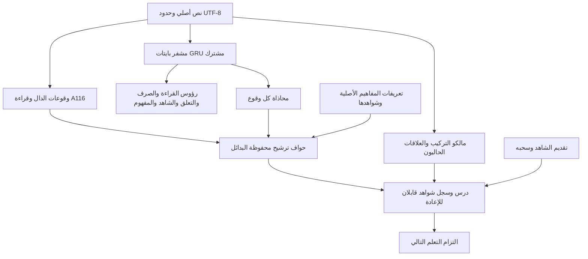

# شبكة الدال والمفهوم المشتركة — تنفيذ وقياس 8 نوفمبر 2026

فُحص NABT عند `288b2ef9c437f31654e2435b0ce9d6088d65a64d`، وقرئت مكوّناته الحالية، مع دفتر التفكيكات المرسل وملفي `Pasted text.txt` و`NABT_Training_Method_20261108_AR.html`. لم يُعامل وصف مشروع آخر أو خطة سابقة بوصفه تنفيذًا حاضرًا في NABT.

التغيير يجمع **منظور الدال S ومنظور المفهوم C فوق مشفر واحد**، ويصل المخرج بمسار الدرس والشاهد الموجود. لا ينشئ مفهومًا معرفيًا وآخر أصوليًا للمعنى نفسه. وقوع اللفظ له معرف مصدر وحدود؛ والمفهوم له معرف التعريف الأصلي. اختلاف نوعي المعرف ضروري لربط عدة وقوعات بالمفهوم نفسه، ولا يعني انقسام هوية المفهوم بين مجالين. فهارس RAG ووسوم المنهج مداخل عرض واسترجاع.

## ما نُفذ



- `cognitive_graph.py` يجمع البايتات ومحارف Unicode وحدود الكلمات وخلايا A116 عندما يقبلها القارئ الصارم، مع نتائج الوصل والوقف. عدم قبول الرسم غير المشكول يُسجل دون إسقاط النص أو اختراع قراءة.
- المفاهيم الثمانية عشر تأتي من مالك التعريفات الأصلي، مع شهاداتها وتجزئات تعريفاتها. تبقى جميع البدائل الثمانية عشر لكل وقوع؛ الدرجة ليست احتمالًا معايرًا ولا دليل انطباق.
- تظل تعريفات المعاجم المتميزة بمعرفاتها الأصلية. وحدة المفهوم بين مجالات الاستعمال لا تجيز دمج تعريفين لمجرد تشابه اللفظ؛ تحتاج مساواة التعريفات إلى شاهدها.
- سجل C يميز مرشحات التعريف عن التطبيقات المؤسسة المقبولة: `admitted_concept_applications` فارغ في هذا المسار. وجود التعريف والفهرسة لا يُسجل إدراكًا لوقوعه ولا يُدخل ترشيح الشبكة في القسم المؤسّس.
- يعاد استخدام `relational.analyze` بكامل مخرجه، بما فيه النقص والبدائل والتزامات الجسر الأنطولوجي. لا يحوّل الفاعل النحوي إلى مريد، ولا التعاقب إلى سببية.
- `cognitive_training.py` يدرب المشفر نفسه والرؤوس الستة: خمس مهام سابقة ومحاذاة الوقوع. عدد المعاملات 8,538. يستخدم حجب الإشراف غير المراجع، وخسارة تقبل مجموعة البدائل، وتعلمًا تقابليًا، واستعادة أمثلة المهام السابقة وتقطير درجات نموذجها، وPCGrad على معاملات المشفر المشتركة.
- الدرس `nabt.cognitive-lesson.v4` يحتفظ بقرار المالك وسجل الشواهد ويضيف الشبكة كملاحظة. الاستدلال أثناء الدرس لا يحدّث الأوزان تلقائيًا. التحديث يتم في تشغيل تدريب معلن؛ الشاهد المسحوب لا يتحول إلى حقيقة نظيفة داخل النموذج.
- المساران الخارجيان `neural.graph` و`cognitive.lesson` يمران بالبوابة القائمة وإعادة التنفيذ من الطلب المستقل. نموذج المحاذاة السابق ومسارات v1–v3 باقية لإعادة القياسات السابقة.

## محاذاة دفتر التفكيكات بالشيفرة

الدفتر يسرد **12 بندًا؛ 3 و14 غير موصوفين**. يحفظ المخرج أربعة عشر موضعًا ويصرح بغيابهما، دون اختراع بندين لإكمال العدد.

| رقم | التفكيك | الموجود الذي يُعاد استخدامه | حدود الإضافة العصبية الحالية |
|---|---|---|---|
| 1 | الدال المتدرج | `nabt.alphabet` و`Machine` و`RecursiveLicensedAlgebra` و`VerifiedReading` | أثر بايتات وقراءة A116 المتاحة؛ لا تعلم صوتي ولا إثبات سماع عام |
| 2 | المدلول وحده | `tools/arabic_training/madlul_matrix.py` والمعجم الأصلي | مصفوفة قائمة؛ لا مصنف متعلم يغطي أقسام المدلول كلها |
| 3 | غير موصوف | — | التزام مفتوح |
| 4 | الاسم والفعل والحرف والدلالات | `Shakhsiyya3Rules` و`LexicalDenotation` و`ConceptContinuity` | محاذاة معانٍ معجمية محدودة؛ لا سبع دلالات مكتسبة لكل لفظ |
| 5 | التركيب | `ProductiveClauseV1` و`AcquiredSyntaxV3` و`ConnectedAcquisitionV3` | حفظ نتيجة المالك؛ التعلم الحر للتركيب غير مغلق |
| 6 | العوامل | `AwamilInventory` و`AwamilRules` ومسار العوامل | فهرسة وتحليل ضمن القواعد المتاحة؛ ليست مئة بوابة عصبية مدربة |
| 7 | النسب | `SibawayhiRules.Isnad` و`MantuqMafhum` وعلاقات المعجم | التقييد واللزوم ضمن المالك؛ لا اكتساب عام لجميع النسب |
| 8 | الفاعلية والمفعولية والسببية | `relations.analyze` وجسور الاستدلال القائمة | حفظ فصل الدور النحوي عن الدعوى السببية |
| 9 | العلامات الإعرابية | `ClassicalBoundaryAffixes` ومسار الإعراب | علامة مشروطة بنوع الكلمة والسياق؛ لا تعميم عصبي لجميع العلامات |
| 10 | المقام | عقود المصدر والسياق ومسار الكلام | لا رأس مكتسب يغطي المقامات كلها |
| 11 | الزمان والمكان | `TemporalContext` والمالك العلاقي | الشاهد الزمني المطلوب محفوظ؛ التمثيل المكاني العام مفتوح |
| 12 | الأجناس والخواص والقابليات | مسار العلاقات وجسر الأنطولوجيا ومعجم المفاهيم | تعريفات أصلية؛ لا شجرة كون مكتسبة ولا قانون قابلية مستنتج من تكرار وحده |
| 13 | الإفادة | المالك التركيبي والاستدلال ودرس المصدر | إفادة مشروطة ضمن نطاق المالك؛ لا رأس عام مدرب للإفادة |
| 14 | غير موصوف | — | التزام مفتوح |

أسماء مثل `AqsamAlmadlul.lean` و`Hawass/Jamad/Wiratha/Tayin` ليست أسماء ملفات NABT الحالية. تُحفظ إحالاتها البحثية دون نسب تنفيذها إلى هذا المستودع أو إدخال تبعية تشغيل إلى مشروع آخر.

## تصحيحات لازمة في المواصفة

1. المنطوق مفهوم دلالي؛ تسمية رسم اللفظ وحده «شبكة المنطوق» تخلط حامل الدلالة بنتيجتها. لذلك يسمى المنظور الأول هنا شبكة الدال، ويبقى المنطوق والمفهوم داخل عمليات الدلالة المشتركة.
2. المطابقة والتضمن والالتزام علاقات تفسير؛ الموافقة والمخالفة والإشارة والاقتضاء والإيماء/التنبيه لا تتحول إلى سبع رؤوس واجبة لكل كلمة منفردة. تسميات `Indication` الحالية تحتاج محاذاة نصية مستقلة قبل ادعاء اكتمال هذا التصنيف.
3. يمكن تمثيل تعريف أو فرضية أو مفهوم معقول مع بقاء تطبيقه على الواقع غير مثبت. التأسيس المطلوب لحكم واقعي لا يُستبدل بدرجة الشبكة، كما أن غياب تأسيس حالة لا يمحو تعريف المفهوم.
4. «غير معروف للنظام» غير «مهمل لغويًا»، وغير «خارج معجم المفاهيم الثمانية عشر». لهذا فُصلت حالة `UNREVIEWED` عن السالب المراجع.
5. الختم يربط التنفيذ بمدخلاته وإصداره؛ لا يصحح الدعوى الخارجية بمفرده. وعدد الشواهد لا يثبت استقلالها أو صدقها. وسقف اليقين يتبع الدعوى ومقدماتها وتطبيق القاعدة، لا اسم الملف أو اجتياز البناء.
6. العلامات الأصلية والفرعية تتعين بشروطها. ولا يعمم شرط «التعذر ووجه من اثني عشر» على كل مجاز دون تثبيت مصدره ونطاقه. لم يُضف مثل هذا الحكم إلى النواة.

## التدريب والنتائج الأولى المحفوظة

بدأ التشغيل من النموذج المشترك السابق، لا من نموذج المحاذاة الذي أظهر نسيان بعض المهام. ثُبتت البذرة 118، و120 خطوة تدريب، و20 خطوة تمهيد تثبت المشفر، ثم يسمح بتحديثه. اختيرت عتبة المحاذاة من التحقق فقط، ولم يختر الاختبار الحقبة أو النموذج. انقطع إعداد أولي قبل إنتاج نموذج أو قياس بسبب خطأ موضع في بيانات النقل؛ صحح الموضع قبل التشغيل المقاس. لا توجد إعادة انتقائية لقياس النموذج المنشور هنا.

من 778 وقوعًا تدريبيًا: **130 موجبًا، و78 سالبًا مراجعًا، و570 غير مراجع بلا إشراف**. ملف المراجعة يتضمن 143 سالبًا عبر الأقسام الثلاثة؛ كلها وقوعات محددة مرتبطة ببايتاتها، وليست قاعدة تعتبر الكلمة سالبة في كل سياق. مجموعة النقل الجديدة: 22 سياقًا مؤلفًا، و18 موضع معنى معلوم، و13 سالبًا مراجعًا. ليست تحكيمًا دلاليًا مستقلًا ولا اختبار مفاهيم جديدة.

| القياس على المواضع المراجعة فقط | النموذج المنشور السابق | الجديد PCGrad | المقارنة دون إسقاط التدرجات | أقرب سياق تدريبي |
|---|---:|---:|---:|---:|
| F1، الاختبار السابق | 0.8036 | 0.7895 | 0.7965 | 0.9421 |
| محاذاة صحيحة مقترحة، من 62 | 45 | 45 | 45 | 57 |
| F1، السياقات الجديدة المؤلفة | 0.6667 | 0.8235 | 0.8235 | 0.8333 |
| محاذاة صحيحة مقترحة، من 18 | 10 | 14 | 14 | 15 |

هذه المقارنة لا تثبت تفوق PCGrad: المقارنة من دونه مماثلة في المجموعة الجديدة وأفضل قليلًا في الاختبار السابق. جُمّدت طريقة PCGrad قبل القياس ولم يُبدّل النموذج باختيار نتيجة اختبار أفضل. الأرقام هنا تختلف عن F1 المحفوظ سابقًا لأن **نطاق المقام هو المواضع المراجعة**؛ أعيد قياس النموذج السابق على النطاق نفسه للمقارنة العادلة.

| الرأس السابق | النموذج السياقي المنشور | نقطة بدء هذا التدريب | بعده |
|---|---:|---:|---:|
| القراءة | 26/27 | 27/27 | 27/27 |
| الصرف | 26/27 | 27/27 | 27/27 |
| التعلق | 26/27 | 27/27 | 27/27 |
| المفهوم على مستوى المثال | 6/18 | 9/18 | 9/18 |
| الشاهد | 38/47 | 41/47 | 40/47 |

بلغ تغير معاملات المشفر L2 مقدار 0.8851؛ فهو تدريب فعلي. أكبر فرق عددي بين PyTorch والاستدلال المحمول أقل من `1.36e-5`، مع تطابق قرارات المحاذاة في المجموعتين. التشغيل على CPU، Python 3.12 وPyTorch 2.15.0+cpu.

**حد مهم:** اقترح الجديد معاني لـ112 من 333 وقوعًا غير مراجع في الاختبار السابق، ولـ30 من 126 في المجموعة الجديدة، مقابل 6 و0 للنموذج السابق. لا تُعد هذه صحيحة أو خاطئة بلا مراجعة، لكنها تزيد عبء المراجعة بوضوح. لذلك المسار `EXPERIMENTAL_NOT_DEFAULT_ALIGNMENT_REPLACEMENT`، وكل حافة ترشيح `accepted=false`. تراجع رأس الشاهد يمنع ادعاء حفظ جميع القدرات. أُرشفت الأوزان والتنبؤات والقياس الأول للتشغيلين دون تعديل النتائج.

## إعادة التشغيل والقبول

```bash
PYTHONPATH=src:. python -m tools.lexical_training.cognitive_training --run-dir artifacts/local/cognitive-new
PYTHONPATH=src:. python -m tools.lexical_training.cognitive_training --gradient-mode sum --run-dir artifacts/local/cognitive-sum-new
PYTHONPATH=src:. python -m tools.grammar_catalog gateway run --request examples/io_gateway/cognitive_graph.json --output artifacts/local/graph.json
PYTHONPATH=src:. python -m tools.grammar_catalog gateway verify --request examples/io_gateway/cognitive_graph.json --receipt artifacts/local/graph.json
PYTHONPATH=src:. python -m tools.grammar_catalog gateway run --request examples/io_gateway/cognitive_lesson.json --output artifacts/local/lesson.json
PYTHONPATH=src:. python -m tools.grammar_catalog gateway verify --request examples/io_gateway/cognitive_lesson.json --receipt artifacts/local/lesson.json
```

اختبارات الإضافة تفحص حجب تدرج المجهول، وصحة إسقاط التدرجات بمثال هندسي مستقل، وحدود المصدر والتشكيل، وتعارض الموجب والسالب، وثبات هوية المفهوم والبدائل، والتزوير، وفقد الأوزان، وسحب الشاهد في الدرس، وتحديث الأوزان الحقيقي وتكافؤ الاستدلال المحمول. توسعت البوابة القائمة `shared-cognition` وCI، مع بقاء النواة والبراهين الرسمية دون تعديل.

المتبقي قبل اعتماد بديل إنتاجي: مراجعة مستقلة للوقوعات غير المراجعة، تحقق مفصول بعائلات وسياقات جديدة، استعادة رأس الشاهد، تقليل الترشيحات الزائدة دون تحويل المجهول إلى سالب، ثم جسور قبول تفسير الوقوع وتأسيس الدعوى الواقعية. تعلم الصوت، واكتساب المقام والإفادة والعلاقات كلها، واكتمال التفكيكات الأربعة عشر **غير مثبتة** بهذا التنفيذ.

مراجع خوارزميتي التدريب: [Gradient Surgery for Multi-Task Learning](https://arxiv.org/abs/2001.06782)، و[Supervised Contrastive Learning](https://arxiv.org/abs/2004.11362). تطبيقهما هنا تجربة محدودة، وليس برهانًا على الإدراك أو على عموم فاعليتهما في العربية.


## سجل التحقق المنفذ

شغّل الفحص العام `make check` اكتشاف الاختبارات كاملًا: **3,503 اختبارات؛ 3,327 ناجحة، و175 متخطاة، وخطأ واحد**. كان الخطأ في عينة اختبار لبصمة البوابة لم تتضمن ملفي النموذج والتدريب الجديدين. أُصلحت العينة، وأضيف إليها اختبار تغيير الأوزان، ونجحت إعادة فحصها.

استُكملت بقية الأهداف بالأمر `make -o test check` مع Lean 4.34.1 وبيئة تدريب CPU؛ نجحت هذه الأهداف، بما فيها إعادة اختبارات البوابة الأصلية والمعجم والشبكة والدروس على التغيير النهائي. لم يُعد اكتشاف الاختبارات العام مرة ثانية، لذلك لا يُسجل هذا بوصفه نجاحًا نظيفًا لاستدعاء واحد من `make check`. تبقى CI مهيأة للاكتشاف الكامل والتدريب الفعلي. انظر [نتائج التحقق والأوامر وبصمات الملفات](../evidence/cognitive_graph_v1/verification/results.json)، ومعها سجل الجولة الأولى وسجل الاستكمال مضغوطين.

في حزم الانحدار المجمّدة، بقيت نتائج التركيب **82/86** والخطاب **68/86**، وكلتاهما `strict_pass=false`؛ نجاح أهداف الانحدار هنا يحفظ الحدود الموثقة ولا يعلن اكتمال العربية.

ملاحظة نطاق: الملاحظة العصبية في الدروس مرتبطة حاليًا بعقدي `source_learning` و`qualified_inference`؛ العقود الأخرى تحتفظ بقرار مالكها مع إعلان عدم وجود محاذاة عصبية لهذا العقد. والتجاور والتتابع شواهد سياقية، ولا يمنحان وحدهما ترخيص الجنس أو السببية.
