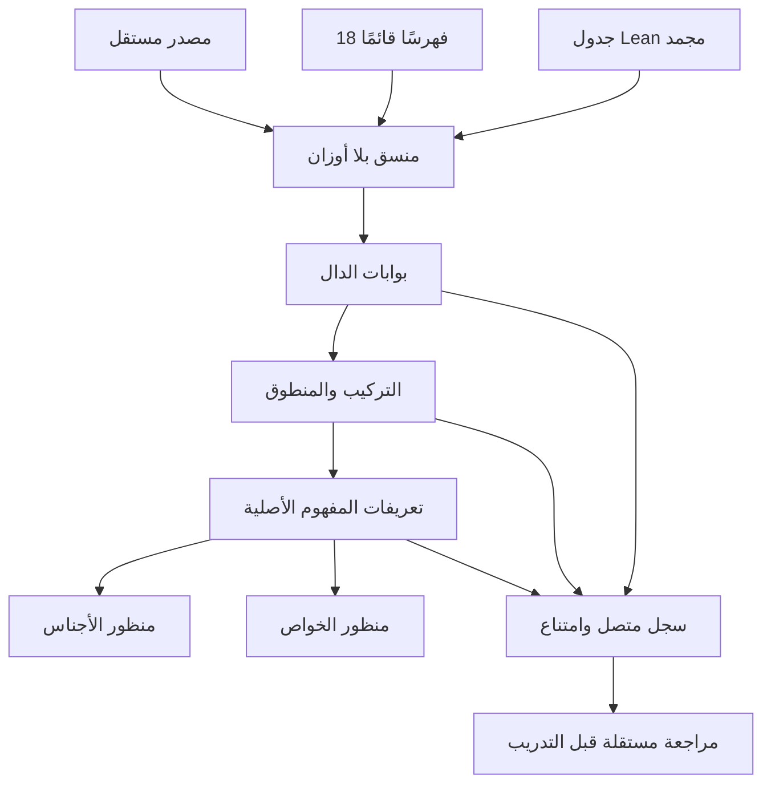

# تنسيق تفسير الحقيقة — عقد تشغيل v1

هذه الدفعة تكمل PR #87 فوق `22e4213849cbc747993847c3802873a1e034738e`.
فحصت سجلات ست وظائف فاشلة في GitHub: توقفت جميعها عند تنزيل Lean بخطأ HTTP 504، قبل الاختبارات التابعة. أضيفت إعادة محاولة محدودة للأخطاء العابرة فقط، مع تنظيف الجزء غير المكتمل والتحقق من SHA-256 قبل التثبيت. فشل البصمة أو 404 لا يعاد ولا يقبل. أظهرت إعادة GitHub الأولى بقاء 504 عند تكرار الرابط نفسه؛ لذلك تتحول المحاولة التالية إلى واجهة GitHub الرسمية للأصل رقم `586761733` مع `Accept: application/octet-stream`. تحققت هوية الأصل وبصمته من API الإصدار، دون مرآة أو تغيير للإصدار. نجح التنزيل البديل في وظائف، ثم كشف اختبار الشبكة حد طلبات API غير الموثق (`403`). تمرر خطوات التثبيت رمز GitHub المؤقت للوظيفة إلى واجهة الأصل الرسمية وحدها، ويحذف ترويس التفويض عند إعادة التوجيه إلى مخزن الملف؛ لا يطبع الرمز ولا يحفظه. اختبارات ذلك تحاكي النقل، ولا تثبت توافر الخادم الخارجي مستقبلًا.

## وحدة الهوية ومناظير الشبكة

S للدال، C للمفهوم، M لربط الدال والمدلول، G للأجناس، A للخواص والقابليات: هذه أسماء مناظير تشغيلية في هذه النسخة. جميعها تشير إلى قائمة المعرفات الأصلية نفسها؛ لا تنشئ مفاهيم باسم الفهرس أو المجال. لم تُدرّب خمس شبكات عصبية مستقلة في هذه الدفعة. المشفر المشترك وأوزان PR #87 باقية؛ التنسيق لا يغيرها.

المنسق `truth-interpretation-dispatch` مؤثر تحكم، `concept_id=null`، بلا معاملات قابلة للتعلم. ليس تعريفًا معرفيًا جديدًا للحقيقة. فهارس RAG الثمانية عشر هي `rag_views.VIEWS` الأصلية؛ لا تستبدل بتعداد آخر لأن قائمة الأبواب في الطلب تجمع موضوعات أكثر من ثمانية عشر وتستخدم تقسيمًا مختلفًا. الجدول المولد يربط جميع المعرفات القديمة بالمناظير وبمرحلة استهلاكها. إعادة استعمال فهرس الصرف لتعيين النوع لا تنشئ فهرسًا تاسع عشر.



## المسار المنفذ

المنفذ الخارجي `cognitive.orchestrate` يقبل المصدر ومعرفه، وقراءة الوصل/الوقف، والنص المعجمي والسياق وفق العقود الموجودة. لا يقبل بوابات أو أعلام قبول أو معرف نموذج من المستدعي.

| المرحلة | المالك المستهلك | شرط التقدم وحدوده |
|---|---|---|
| الإملاء | `unit_composition.execute(source)`، القارئ الأصلي للاكتساب، A116 | حفظ المصدر والحدود، وقراءة كل كلمة وإيصال شكلها؛ لا يكفي نجاح تحويل Unicode |
| الصرف | `read_inflection` والمعجم المصدرّي | بدائل صرفية مستندة ذات تقطيع مرخص ودون التزامات صرفية معلقة لكل وقوع؛ لا ادعاء اكتمال جميع قوالب العربية |
| النوع | إسقاط من تقرير الصرف نفسه | الأنواع اسم/فعل/حرف مع حفظ جميع البدائل؛ لا ترجيح إحصائي يحذف احتمالًا |
| التركيب | `read_discourse` | تحليل مرخص لكل جملة ضمن نطاق القارئ؛ تبقى التحليلات كلها محفوظة |
| المنطوق | تقرير التركيب نفسه | تعيين القوة الخطابية واستيفاء الإحالات في تحليل مرخص؛ الخبر دعوى مصدرية والطلب لا يثبت وقوع فعله |
| المفهوم | `cognitive_graph.analyze` القائم | إنتاج مرشحات مرتبطة بالتعريفات الأصلية؛ قبول التطبيق المؤسس يظل `DEFER` لغياب جسر شاهده |

تصنيف الخبر/الإنشاء لا يمكن اعتباره حقيقة قبل تحليل الجملة. قد ينتج القارئ فرضيات أثناء التحليل، ثم يثبت التصنيف في تقرير المنطوق. لم يُضف اختصار دائري يمنح الترخيص من تصنيف مفترض. الجرد الأصلي للعوامل يبرهن `100 = 91 + 7 + 2`؛ لا يتضمن جدولًا يثبت تقسيمها إلى `82/18` حسب الخبر والإنشاء، لذلك لا يستخدم هذا التقسيم لحذف عوامل.

السطر المسترجع هنا وصف القدرة وشواهدها ومراجعها من الفهرس القائم. ليس استرجاع ذلك السطر دليل انطباقه؛ التقرير التنفيذي الكامل من مالكه هو سجل البوابة. يحمل كل إرسال معرف المصدر وبصمته، والطبقة السابقة، والقيد، والسطر وبصمته، والبوابة، وتقريرها وبصمته، وسقف الدعوى. عند التعذر لا يستدعى المالك الأعلى. يبقى النص غير المشكول توقفًا صريحًا حيث لا تغطيه قراءة مرخصة.

## برهان المنسق وفحصه

مدد `Nabt.RuleRouting` بأربع مبرهنات: الإرسال المقبول يحفظ الطبقة، ويحتاج القيد، وفتح المجاز في هذا الملف التشغيلي يحتاج استبعاد الحقيقة والقرينة، والتوقف لا يقدم المؤشر. أدخلت أسماؤها في `formal/theorems.json` و`Audit.lean` الموجودين. جدول `dispatch.json` مستخرج من `ExportCognitiveDispatch.lean` ومثبت ببصمته في المستهلك. هذه سياسة تشغيل مشروطة، وليست برهانًا على اكتساب المقدمات من النص أو تعريفًا لكل المجاز في العربية.

يفحص `check_cognitive_dispatch.py` الجدول مقابل المصدر التنفيذي في Lean، ثم يقارن جميع 36,864 حالة مع مرجع مستقل لمجموعات الشروط: ست طبقات حالية × ست مستهدفة × أربعة ملفات × 256 قناعًا. اختلاف الجدول أو إدخال bool بدل عدد يفشل. تبقى مطابقة Python العامة لـLean خارج هذا الفحص المحدود.

## الأبواب الخاصة وحدود التنفيذ

| الباب | الشرط المثبت في سياسة الإرسال | حال الوصلة |
|---|---|---|
| المجاز | شاهد استبعاد القراءة الحقيقية + قرينة سياقية محلية | مغلق: لا تحول كلمة مجهولة أو غياب نتيجة استرجاع إلى تعذر حقيقة؛ استخراج حزمة الشاهد من مالك الحقيقة مفتوح |
| القياس | حزمة علة جامعة منطبقة مع نطاق الزمان والمكان أو مستند عدم التعلق بالإحداثيات | مغلق: وجود إحداثيات وحده لا يثبت العلة؛ وصلة الحزمة إلى المالك مفتوحة |
| السبر والتقسيم | حزمة أدوار مميزة للخاصية والشرط والسبب والمانع | مغلق: لا تعمم «لكل خاصة سبب معلوم» أو «كل فرز يحتاج مانعًا موجبًا»؛ وصلة الحزمة مفتوحة |

البوابات الخاصة لا تقبل رايات من الطلب. اختبارات الأقنعة تثبت سياسة حراسة هذه الأبواب؛ لا تعني أنها اكتسبت شواهدها أو أجرت قياسًا واقعيًا. كذلك لا ينشئ هذا العمل ترتيبًا زمنيًا ملزمًا لكل حقيقة لغوية ثم عرفية. النوع والنطاق والحقبة والشاهد تحفظها عقود المصدر.

سقوف النتائج قيم وصفية مختلفة لكل دعوى، محفوظة دون تحويلها إلى رقم يقين واحد أو رفعها من قوة الختم. النتيجة العامة `DEFER` عند قبول المفهوم الواقعي، حتى لو أغلقت المراحل اللغوية المشروطة. سجلات الدورة لها إحالات متصلة، لكنها لا تصبح تسميات تدريب موجبة تلقائيًا؛ يلزم التحكيم ومنع تسرب الاختبار. لم ينفذ تدريب عصبي جديد أو تحديث ذاتي في هذه الدفعة.

## التشغيل

```bash
make cognitive-orchestration LAKE=/path/to/lake
PYTHONPATH=src:. python -m tools.grammar_catalog gateway run --request examples/io_gateway/cognitive_orchestration.json --output artifacts/local/orchestration.json
PYTHONPATH=src:. python -m tools.grammar_catalog gateway verify --request examples/io_gateway/cognitive_orchestration.json --receipt artifacts/local/orchestration.json
```

يبقى `nabt.io.result.v1` المقبول بإعادة التشغيل مع الطلب المستقل هو المخرج الخارجي. تقرير المالك الخام ليس شهادة خارجية. نتائج الفحوص الفعلية وحالة GitHub تسجل بعد التشغيل في سجل التحقق؛ لا تستنتج من وجود هذه الأوامر.

## إصلاح اكتمال الفهارس وتجميد الفاحص

كشف الفحص العام غياب `article_proof_links.json` و`sourced_proof_links.json` عن المرجع المجمّع الجديد. ولدا بواسطة فاحصي المصدر الموجودين، وربطا ببصمة الفهرس نفسه؛ لم تنقل بصمة بالتحرير اليدوي. كشفت إضافة مصادقة التنزيل أيضًا أن CI مقيد بتجميد سابق يسمح بتغيير زمن التنفيذ فقط. الإصدار الثالث الجديد لتجميد تبعيات الفاحص يحتفظ بالإصدارين السابقين ويعكس تعديلين تشغيليين محددين بايتيًا: الزمن السابق وإدخال رمز الوظيفة في خطوة تثبيت Lean المعينة. تظل الأوامر والصلاحيات والحالات والتقييمات الدلالية مطابقة للتجميد الأصلي. لا يقبل الحارس إدخال رمز آخر أو تغيير صلاحية أو تكرار الإعداد.

اجتازت اختبارات التنزيل وترحيل CI والفهارس والفاحص القديم 26 اختبارًا بعد الإصلاح. سجل الفحص العام الأول يتضمن إخفاقات ما قبل هذا الإصلاح؛ النتيجة النهائية تعتمد على التشغيل اللاحق المثبت في PR، ولا يعاد توصيف الفشل الأول بأنه نجاح.
