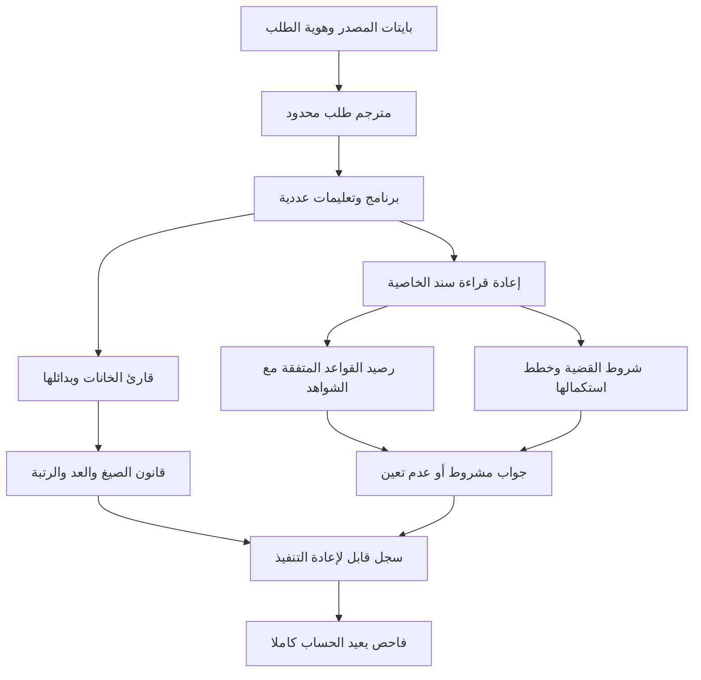

# NABT: التنفيذ النهائي المستفيد من التجارب السابقة

## القرار المعماري

NABT هو موضع التنفيذ والتكامل والنشر. تُعاد صياغة العقود المفيدة داخله، وتُبنى
براهينها محليًا، وتُختبر واجهاتها. لا يحتاج تثبيته أو تشغيله إلى استنساخ Mashru
أو Alghanem أو Qeyas أو Taaqol-GPT. يبقى لكل مصدر مرجع ثابت، ولكل نتيجة مجال
محدد. لا تتحول كثرة أسماء المبرهنات إلى سلطة على مادة جديدة.

التطوير `0.3.0a1` يجمع العمل المحلي `2d7a80d` فوق المنشور `f48012e`، ثم يضيف
الجسور العددية، وسند الخصائص، وتعلم القواعد المحدود، وحساب المطلوب الأدنى،
ومفسر برامج عددية قابلًا لإعادة التنفيذ. مرجع المقارنة هو هذه النسخ، لا ملخصات
المحادثات ولا أرقام اختبارات من فروع أخرى.

## ما استفدناه، وموضع تنفيذه

| المصدر المثبت | ما انتقل إلى NABT | درجة الاعتماد وحدوده |
|---|---|---|
| Mashru `e4c801ffe9171dadedcc3aae23051ea0953ae361` | ترتيب خلايا الدال وSLGE؛ اختلاف `encL` عن العدد الكبير النهاية؛ منهج الصيغ والأثر والعد؛ حساب الاستكمالات | الجسور وحساب الاستكمال أعيد بناؤهما وبرهنتهما. قانون الصيغ الموجود سابقًا يحتفظ بمرجعه التاريخي وإصداره؛ لم يتغير قبول اللغة ضمنيًا |
| Alghanem `9d8fa03a51f894416e0abaf3b6821c5ae6441dcd` | الفصل بين ترتيب A116 وترتيب الجسر، وحفظ الهوية عبر العمليات | محولات عددية محلية؛ لا يستورد قبول البوابة القديمة أو بقايا الشهادة سلطةً |
| Qeyas `0ac045125f3d4ed9a984ab2f78a787fe9d014cd9` | الرصيد الكامل للقواعد المرشحة، سند الخاصية، إعادة القراءة، تغير الشواهد، فصل المجهول والمنفي والتعارض | نقل أصلي داخل `nabt.learning` مع حقوقه، وإعادة بناء 32 مبرهنة محليًا. هذا المصدر فرع مراجعة، وليس ادعاء دمجه في main هناك |
| Taaqol-GPT `91dad107a7d56e6e05cce4ab54c3d63e5bdf5482` | هوية محفوظة، عقود العمليات، البدائل، بقايا الالتزامات، إعادة الفحص عند الاستعمال | دخلت هذه المبادئ أساس `0.2.0a1`؛ لم تُستورد درجاته أو أعلامه باعتبارها دليلًا |
| alghanem-constitution `f75a43b9f4ed3df059f1feb832f48d96e6f846ba` | صيانة المادة الخام وفصلها عن تفسير الرسم والقراءة | يستفيد القارئ وهوية المصدر من العقد؛ التاريخ المعلّق في المستودع ليس قانونًا نافذًا في NABT |
| hamil-constitution `3fd531b87fba4f5312cd911c1038db38e3f84618` | فصل المدلول عن مجرد رقم الدال | حد معماري معلن؛ لم يُبن محلل معنى عام ولا يُمنح حكم دلالي من نجاح الترميز |
| dal-madlul-constitution `0c2ca948de44bd44f1f61c2e44ea01896ff5ad1d` | وجوب فحص الرابط بين الدال والمدلول | هوية قضية وسياق وتعريف وسياسة؛ الرابط الدلالي العام ما يزال التزامًا لاحقًا |
| hamil-hala-zaman-program `232821b7a19498da4727fd731d2859eb45d14ef9` | فصل الحامل والحالة والموضع/الزمان، وتسمية موضع العجز | وقوع مقيد بالمصدر والقراءة، وتعليمات ومسار عددي ومطلوب مسمى؛ لا يحول الثلاثي وحده أي معنى إلى مبرهنة |
| Algebra `5d131b565e9fd953cbb625b538aae050ce1fef5d` | محاسبة ما عُبر وما بقي، وفصل عدد الشواهد عن القياس المستقل | النتيجة تسجل كل خطوة وسبب توقفها؛ القياس المحجوب صفر حاليًا في التجربة اللغوية ولا يُستبدل باختبار الفاحص |

تسمية «الدال» هنا تطابق وصف `alghanem-constitution`، و«المدلول» وصف
`hamil-constitution`، و«الدال والمدلول» وصف `dal-madlul-constitution` في
المستودعات التي فُحصت. ليست هذه أسماء مستودعات جديدة مفترضة.

الفهرس [upstream_theorems.json](../evidence/upstream_theorems.json) يحفظ تصريحات
المبرهنات المستخرجة من تسعة مصادر، مع الملف وبصمته وموضع التصريح. هو فهرس
نصي، **وليس نتيجة بناء جميع مشاريع Lean السابقة**. المرجع الوحيد للمبرهنات
المبنية والمعتمدة في NABT هو `formal/theorems.json` وتدقيق `Audit.lean`.

## المعمارية التنفيذية



العمليات تُفسّر بيانات محدودة؛ لا تُشغّل شيفرة يقدمها المحتوى، ولا تسمح له
باختيار قانون بديل أو رفع مرتبته. التعليمات الموجودة الآن هي:

| الرقم | التعليمة | الشرط والنتيجة |
|---:|---|---|
| 1 | `READ_UTF8` | قراءة صارمة مع حفظ البايتات؛ لا يُسقط ترميزًا فاسدًا |
| 2 | `WORD_SHAPE` | نص واحد إلى بدائل الصيغ أو شهادة الصيغة المكتملة |
| 10 | `START_LEARNER` | إنشاء كل الفروض في لغة الشروط ذات الدرجة المحددة |
| 11 | `OBSERVE_SOURCE` | إعادة قراءة شاهد معروف بالسياسة، ثم حساب سمة وقيمة ووسم مستقل |
| 12 | `WITHDRAW_SOURCE` | سحب سند فعّال وإعادة الحساب من جميع الفروض؛ السحب لا ينفي الشاهد |
| 13 | `QUERY_CUE` | قراءة القرينة الحرفية ومقارنة كل الفروض وكل استكمالات السمات الناقصة |
| 20 | `APPLICATION_OBLIGATIONS` | استخراج شروط الجزء المحدود من باب الأسماء الستة وحساب المطلوب المسمى |

للتعليمة عدد قابل للعكس مشتق من تمثيلها المعياري، وللبرنامج عدد مستقل وهوية
ABI. يُحفظ الطول بإضافة بايت بادئ قيمته 1 قبل تحويل البايتات إلى عدد كبير
النهاية. لا يقبل المفكك أي عدد ذي بادئة أو بنية غير معيارية. البراهين الحالية
في `Nabt.Program` تثبت هوية **أرقام العمليات** وفك قائمة العمليات وتركيب
مجالاتها؛ براهين تسلسل A116 مستقلة. ترميز JSON/UTF-8 للبرنامج الكامل ومفسر
Python مفحوصان باختبارات، ولم تُكتب لهما بعد مبرهنة تنقيح كلية.

## كيف يقود الجبر

### هوية الخانة وهوية السلسلة

الخانة `a = 4c + v` تحفظ الحامل والحالة ضمن الأبجدية المحددة. وقوعها المحلي
`116p + a` لا يغني عن المصدر ونسخة القراءة. عدد السلسلة يحقق:

\[
F(\epsilon)=0,\quad F(u\cdot a)=116F(u)+(a+1),\quad
F(uv)=116^{|v|}F(u)+F(v).
\]

تعالج الجسور اختلاف ترتيب الحوامل واتجاه العدد. مثال قابل لإعادة الفحص:
`كَتَبَ` عدده في ترتيب Mashru الدالي `452621`، وفي NABT `1144809`.
الجسر يحفظ النص نفسه. والعدد `1` في جسر Alghanem يدل على `ءَ`، فيتحول إلى
`113` في NABT، لا إلى `اَ`. الاختلاف يشمل ثماني خانات بين جسر Alghanem وNABT.

### التعلم عملية على مجموعة الفروض

يعبر الشرط عن زوج قناعين لا يتداخلان: سمات مطلوبة `P` وسمات ممنوعة `N`:

\[
h(x)=[x\mathbin{\&}P=P]\land[x\mathbin{\&}N=0].
\]

ولكل حالة قناع معلومة `known` وقناع قيمة `value`. البت غير المعروف ليس صفرًا
مثبتًا. إذا كان عدد السمات `m` وأقصى درجة `d` فعدد الفروض، مع الثابتين، هو:

\[
|H|=1+\sum_{j=0}^{d}{m\choose j}2^j.
\]

كل شاهد يُدخل بعد إعادة قراءته، ثم يُستبعد فقط الفرض المخالف. وعند سحب شاهد
تُعاد التصفية من `H` الكاملة، فتعود الفروض التي فقدت سبب استبعادها. لا يكفي
إبقاء الفرض الأخير ثم تعديل اسمه. إجماع الفروض المتبقية استنتاج مشروط بهذا
المجال وصحة السمات والشواهد؛ لا يثبت أن المجال المختار يحتوي قانون العربية.

في التجربة الفعلية ذات السمات الثلاث والدرجة الأولى يظهر المسار
`8 → 4 → 2 → 1`. الدرجة الثالثة تبقي **خمسة فروض** على الشواهد نفسها. هذا
فحص يمنع إخفاء أثر اختيار لغة الفرضيات داخل عبارة «اكتشف النظام القاعدة».

### حساب المتبقي

يُعرّف كل مطلوب بهوية كاملة: الاسم، المصدر، الوقوع، القراءة، السياق، التعريف
والسياسة. يتحول إلى بت داخل سجل هذه القضايا، ولا يُستخدم الرقم خارج سجله.
في الصيغ الموجبة يُنتج الاقتران اتحاد خطط الجزأين، والفصل بدائلهما، ثم تُحذف
الخطط المحتواة على نحو صارم وتُزال النسخ المتساوية.

للصيغة `(A ∨ B) ∧ (A ∨ C)` تكون الخطط `{A}` و`{B,C}`. كلاهما أدنى
**بالاحتواء**؛ حذف الثانية لأنها أطول يُفقد بديلًا صحيحًا. يسبق فحص التعارض
المتعلق بالقضية إسقاطها إلى حكم مبسط. التناقض خارج القضايا المستعملة يبقى
مسجلًا ولا يعطل هذه الصيغة. غياب خطة لا يدّعي الامتناع خارج المجال المعلن.

يُعاد بناء البرنامج المحسوب عند استهلاكه للتحقق من الحقول المشتقة. وتفحص
ميزانية البحث وحجم المخرج قبل التوليد الكبير؛ تجاوزها `DEFER` بسبب الموارد.

## تجربة عربية من المصدر إلى مراجعة الجواب

تدخل ثلاثة شواهد فعلية من السياق المحدد في كتاب سيبويه: «هذا هنوك»، «رأيت
هناك»، «مررت بهنيك». تقرأ سمة الإدخال من القرينة الحرفية، ويُقرأ وسم المخرج
من الحرف السابق للكاف في الهدف، مع انفصال مجال البايتات بينهما. لا يُدخل
النظام حكم الرفع أو النصب أو الجر بوصفه معلومة استخرجها نحويًا من نص مفتوح.

السؤال الرقمي المحدد هو: هل الحرف الملاحظ في هذا الإسقاط واو؟ بعد الشواهد
الثلاثة تتفق الفروض ذات الدرجة الأولى. عند سحب الشاهد الثالث يصبح جواب
قرينة «مررت، ب» قابلًا للوجهين، وعند إعادته يعود الجواب المشروط السابق.
قرينة غير معروفة تحتفظ بثلاث سمات ناقصة. المثال يقيس إعادة الحساب وتأثير
السند؛ لا يقيس تعميمًا لغويًا على مرجع محجوب.

تُقرأ أيضًا ست عبارات قواعد من قطر الندى والألفية ضمن مخطط آخر. هذه عملية
ترجمة نص قاعدة إلى تمثيل، وتبقى منفصلة عن اكتساب علاقة من الأمثلة. بيانات
المصادر كاملة، وتُراجع بصماتها وحدود بايتاتها، ولا يسمح ملف JSON مرافق بتغيير
السياسة المركبة في الفاحص.

## التشغيل وإعادة الفحص

```bash
python -m pip install .
nabt transcode 452621 --from-codec mashru.dal.adad.v1 --to-codec nabt.bijective116.v1
nabt compile examples/word_shape.json
nabt run examples/word_shape.json > shape-receipt.json
nabt verify-run shape-receipt.json
nabt run examples/unvocalized_word.json
nabt run examples/dhu_obligations.json
nabt run examples/source_learning_revision.json > learning-receipt.json
nabt verify-run learning-receipt.json
nabt pilot
```

يمكن تمرير `program_number_hex` الناتج من `compile` إلى `nabt execute`.
`verify-run` يقارن السجل كاملًا بإعادة التنفيذ؛ لا يكفي تطابق البصمة أو ملء
حقل `trusted`. `COMPLETED` يعني اكتمال تنفيذ الطلب وقد تكون نتيجته `PENDING`؛
يجب قراءة مجال النتيجة وحالتها. لا تحمل هذه الواجهة دعوى توقيع منشئ السجل.

## حدود الإطلاق

هذه نسخة تجريبية **للتكامل والحساب والاستدلال المشروط**. تثبت قدرة الآلة على
الحفظ العددي، والعكس، والعد، وفحص السند المحدد، وصيانة البدائل، وتغيير جواب
متأثر بسحب شاهد، وإظهار المطلوب. لا تثبت فهم كل نص عربي، ولا اكتمال السماع
والجذور والصرف والنحو والدلالة، ولا AGI، ولا منافسة نموذج عام.

لا يدخل برنامج التعلم الحالي سجلًا جديدًا بمجرد تسميته؛ يلزم بناء قارئ
وشروط إدخال أوسع بإصدار جديد. أما المواد غير المكتملة فتجد مسار تعليق صريحًا
بدل الترقية. معيار «جامعة مانعة» القابل للفحص الآن هو السلامة والشمول داخل
كل لغة وواجهة معلنتين، مع بقاء اكتمال التغطية اللغوية هدفًا يقاس مستقلًا.

خطة الإكمال وبواباتها في [ROADMAP.md](ROADMAP.md)، وحدود كل برهان في
[PROOF_STATUS.md](PROOF_STATUS.md)، ونتائج هذه الجولة في
[`evidence/integration/`](../evidence/integration/).
