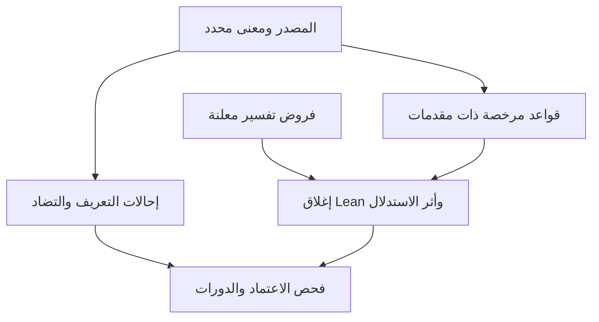

# شبكة الدلالة المشروطة في NABT

ينفذ القانون `nabt.lexical-graph.v1` شبكة دلالة قابلة للتشغيل في Lean،
مرتبطة بكتالوج المعاني وقوانين المطابقة والتضمن واللزوم الموجودة.
النتيجة المبرهنة هي **أصغر إغلاق استدلالي بالنسبة إلى القواعد والمقدمات
المعلنة**. وجود دائرة تعريفية لا يثبت معنى، ولا يولد مقدمة، ولا يحسم
مراد المتكلم أو الواقع. لم يثبت اكتمال العربية كلها.

## تصحيح أساس المقترح

الدورة `أرض ← سفل ← قرر ← أرض` المقترحة لا تحمل في المصادر المثبتة
الأدلة اللازمة لتحويلها إلى قواعد. كما أن الرجوع إلى نقطة البدء ليس
«لا دورية»؛ يمكن أن تكون شبكة الإحالات دورية وخوارزمية فحصها منتهية.
الحل أن نحفظ الإحالة، ونمنعها من توليد استلزام لم يمنحه المصدر والقانون.

توجد في لسان العرب دورات إحالة فعلية: الخروج/الدخول، والعلم/الجهل،
والصدق/الكذب. العلاقة فيها تضاد منقول؛ لذلك لا يستنتج النظام الدخول من
الخروج أو الكذب من الصدق. يراجع [تقرير المصادر](LEXICAL_GRAPH_SOURCE_REVIEW_AR.md)
أيضًا افتراض الوعاء المغلق لكل «خارج»، وتعميم معنى الطلب على استفعل،
وخلط «نار الحرب» بإثبات احتراق مادي.



لا يوجد سهم استدلال من شبكة الإحالات إلى الإغلاق. البحث المتجهي يمكنه
اقتراح مقاطع للمراجعة، ولا يضيف قاعدة أو فرضًا. توثيق pgvector يصف بحث
الجيران الأقرب؛ فالدقة فيه دقة استرجاع بالنسبة إلى المتجهات، وليست صحة
لغوية. ولأي عددين موجبين `a,b`، يكون المتجهان الثابتان `a·1` و`b·1`
متوازيين، فمسافة cosine بينهما صفر مهما اختلف النصان. لذلك لا تُستعمل
قيم `array_fill` الاصطناعية شهادة دلالية.

## الجرد المثبت

| العنصر | العدد والنطاق |
|---|---|
| القراءات | 42 قراءة مؤلفة على 30 فهرس مادة؛ ليست 30 جذرًا صرفيًا مثبتًا |
| التفسير | 41 مفسرة، وقراءة الشمس الإشارية معلقة |
| العقد | 91: تمام التفسير، ومكوناته المعلنة، وثلاثة لوازم ذهنية |
| قواعد الاستدلال | 90، لكل منها مصدر وهوية معنى ومجال؛ لا مقدمات فارغة |
| إحالات المصدر | 6 حواف في ثلاث دورات تضاد، بلا سلطة استلزام |
| شهادة المصدر | مقابلة المقاطع ببايتات النسخ المثبتة؛ التواتر غير مقيم |

يحفظ `sense_id` قراءة «عين» المالية مستقلة عن البصر والعين الجارية
والجاسوس والحرف. ولا يحول اشتراك عقدتين في نص مكون واحد إلى تطابق
هويتهما. لا تقسم عبارات التعريف تلقائيًا إلى جذور أو أجزاء فيزيائية.
تظل المكونات والتأويلات الحالية مؤلفة وغير محكمة استقلالًا.

قواعد الرسم ثلاثة أنواع: إسقاط مكون من تمام التفسير، وتركيب تمام
التفسير من **جميع** مكوناته، ولزوم ذهني مسند إلى قراءة بعينها. يُعرّف
تمام التفسير هنا بأنه اجتماع المكونات المعلنة. هذه مقدمة نمذجة ظاهرة،
وليست استنتاجًا أن كل شرح معجمي يمثل تعريفًا ماهويًا تامًا. لا يكفي
وجود طريق من مكون واحد لإتمام قاعدة متعددة المقدمات.

## البرهان العام وحدوده

لتكن `S` المقدمات المعلنة، و`R` القواعد المقبولة، و`B(r)` مقدمات القاعدة
و`h(r)` نتيجتها. الإغلاق المقصود هو أصغر مجموعة تحتوي `S` وتحقق:

\[
 B(r)\subseteq I \Longrightarrow h(r)\in I \quad (r\in R).
\]

يبدأ التنفيذ بـ`S`، ويضيف رأس قاعدة حين تكون مقدماتها كلها متاحة.
لا تنشط القاعدة إذا كان رأسها موجودًا، وتُزال من قائمة الانتظار بعد
تنشيطها. لذلك عدد القواعد حد كاف للتنفيذ، دون اشتراط عمق خمسة أو
افتراض سقف لغوي اعتباطي للجذور.

| العقد البرهاني | ما يثبته |
|---|---|
| `lowered_edge_guards` | حفظ مصدر القاعدة وهويتها ومقدماتها، مع شروط المعنى والمجال |
| `reference_edge_not_lowered` | إحالة التعريف أو التضاد لا تدخل قواعد الاستدلال |
| `scan_activation_bound` و`scan_finishes_by_rule_count` | حد التنشيطات وانتهاء الفحص عند توفير الحد الكافي |
| `scan_replays` و`completed_certificate` | كل إضافة قابلة لإعادة التشغيل بالحساب القائم؛ النتيجة المكتملة شهادة إغلاق |
| `completed_exact` | العضوية في النتيجة المكتملة تكافئ قابلية الاشتقاق في البرنامج المحدد |
| `completed_empty_without_seeds` | دون مقدمات لا تنتج الدورة دعاوى؛ لا استدلال ذاتي الدعم |
| `completed_model_sound` | صدق النتائج مشروط بصدق المقدمات وحفظ القواعد للمعنى |

أضيفت 19 مبرهنة عامة مع إعادة استعمال `SemanticInference` و`VerifiedReading`
و`LexicalDenotation`. سجل المشروع 1456 تصريحًا و1453 بنية عبارة متميزة؛
لم تضف المرحلة أسماء مكررة لبنية عبارة سابقة. جميع المسلمات المرصودة
ضمن `propext` و`Classical.choice` و`Quot.sound`، ولا مسلمات مشروع.

يجب فصل ثلاثة مستويات: برهان Lean على الخوارزمية الصورية، وتشغيل
البرنامج الأصلي المترجم، وصحة تحويل المصدر إلى مقدمات. المحول Python
يعيد مقابلة المصادر، ويعيد بناء الرسم، ويفحص تراخيص قواعده عبر الفاحص
الأصلي الموجود، ويقارن إيصال التشغيل مقارنة تحفظ أنواع JSON. **لم يثبت
تنقيح المحول Python صوريًا**؛ ولا يولد كل طلب برهانًا جديدًا مفحوصًا
مستقلًا في النواة. سلامة المترجم والنقل والتنفيذ جزء من حدود الثقة.

## التشغيل والهندسة العكسية

```bash
python tools/fetch_lisan_source.py --output artifacts/local/lisan.txt
lake --dir formal build lexicalCompletion lexicalGraph
python tools/build_lexical_graph.py --check
python tools/lexical_graph.py --inventory
python tools/lexical_graph.py --request evidence/lexical_graph_v1/example_request.json
python tools/benchmark_lexical_graph.py --output artifacts/local/graph/benchmark.json
```

مثال الطلب يصرح بافتراض قراءة الخروج، ويختبر مكونها وقراءة الدخول.
المكون مشتق تحت الفرض؛ الدخول غير مشتق في الرسم المثبت. يعيد الإيصال
هويات القواعد المنشطة والبصمات والمقدمات، ويعرض `reverse_dependencies`
جميع المتطلبات السابقة للهدف دون الادعاء باكتسابها. هذا هو التفكيك
العكسي المرخص؛ ليس اختيار `edges[0]` أو تجاهل الفروع الأخرى.

`RESOURCE_EXHAUSTED` لا يعني بطلانًا لغويًا: النتيجة المثبتة في الجزء
المنفذ تبقى مشتقة تحت فرضها، والهدف غير المحسوم يصبح
`UNKNOWN_RESOURCE_EXHAUSTED`. المصدر المفقود والتفسير المعلق والهوية
المجهولة وتعذر الفاحص حالات مستقلة. لا يقبل الطلب مصادر أو أوزان ثقة
أو درجات متجهية من المستخدم لترقية سلطة النتيجة. تُرفض الأعداد الكسرية
والمنطقية مكان الميزانية والمفاتيح المكررة، وتحفظ الإيصالات نسخًا مستقلة
كي لا تؤثر تعديلات المستخدم عليها في التشغيل التالي.

## القياس والتكامل

يقارن الأوراكل المستقل 4096 حالة: 512 رسمًا من تسعة قوالب قواعد على
ثلاث عقد، مضروبة في مجموعات الفروض الثماني. يحسب تقاطع **كل المجموعات
المغلقة المحتوية على الفروض**؛ لا ينسخ خوارزمية الإغلاق التنفيذية.
هذه عينة مستنفدة لمجال اصطناعي معلن، وليست جميع الرسوم ولا استعمالات
العربية. توجد أيضًا ثمانية ضوابط للكتالوج المثبت و29 طريقة اختبار
للحدود والمصادر والنقل. لم تتغير نتيجة الاستعمال الطبيعي السابقة 0/6.

تدمج `integrations/lexical_graph.mk` الفحوص دون تغيير Makefile التاريخي.
بوابة GitHub القائمة تشغّل المدقق الأصلي والأوراكل. جُددت فهارس ربط
النحو والمنطوق والحقيقة اللغوية والاستدلال ببراهين المشروع في مجلد هذه
المرحلة، مع إبقاء اللقطات السابقة. الموقع الحي لم ينقل إلى هذا المسار.

يوجد [امتداد PostgreSQL اختياري](../integrations/inference_db/LEXICAL_GRAPH.md)
ذو سبعة جداول ذات مفاتيح مركبة وختم يمنع التعديل. يخزن مرشحات القواعد
والمصادر؛ ليس مدخلًا عامًا للقبول ولا محولًا منفذًا إلى الرسم المثبت.
خمس فحوصه الساكنة نجحت محليًا؛ اختبارات PostgreSQL التسعة تحتاج الخادم
ولم تُنفذ محليًا. بوابة قاعدة البيانات القائمة تكتشفها عند تشغيل GitHub.

## الالتزامات الباقية

الانتقال إلى اكتمال لغوي أوسع يحتاج جرد قراءات مرجعي مستقل، وتحكيم
المكونات واللوازم، وقواعد جسور مرخصة بين المعاني والمقامات، واكتساب
الفروض من النص الحر، وقياسها في استعمال طبيعي محجوب عن التطوير.
صدق الواقع وتواتر النقل مستقلان عن ذلك كله. لا نرفع رتبة الشهادة بمجرد
دورة أو نجاح اختبار أو تشابه متجهين.

المراجع التقنية: [طبقات Lean والنواة](https://lean-lang.org/doc/reference/latest/Elaboration-and-Compilation/)،
[حدود التحقق من البراهين](https://lean-lang.org/doc/reference/latest/ValidatingProofs/)،
[توثيق pgvector](https://github.com/pgvector/pgvector).
