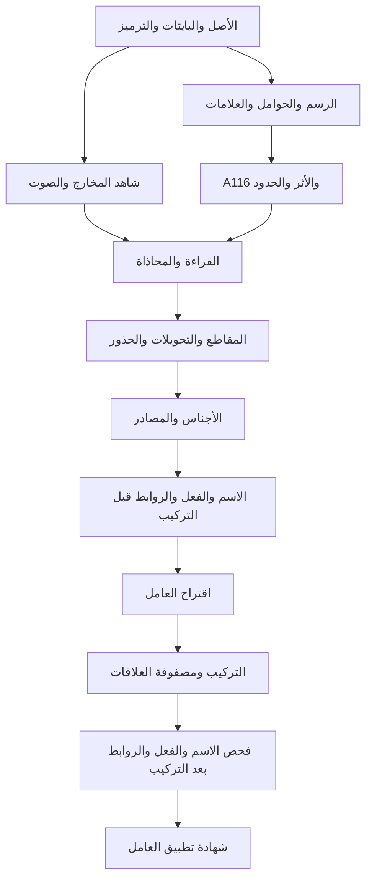

# تنظيم وكلاء العربية وRAG وفهرس المبرهنات في NABT

## نطاق هذا التنفيذ

فُحص الأصل `99fa295c4a1691185cdb28ecb22099866e56408e` بعد دمج PR 80.
ينظم هذا الامتداد **33 تخصصًا لوكلاء المشروع و113 موضوعًا مطلوبًا** داخل
[إطار التعلم الموجود](../evidence/cognitive_curriculum_v1/learning_framework.json)،
ويربطها بمالكي القواعد وواجهات التشغيل ومصادر البحث والمبرهنات الحالية.
التخصصات تعتمد على الوكلاء الأربعة عشر والأهداف الستة والستين الموجودة؛ ليست
33 نموذجًا عصبيًا دُرّبت أوزانه بصورة مستقلة.

فهرس البرهان الوحيد المختار بواسطة
[`current_proof_references.mk`](../integrations/current_proof_references.mk)
يحوي 1608 تصريحات في اللقطة الحالية. العد يشمل أنواع التصريحات المفهرسة،
ولا يعني 1608 قاعدة عربية مكتملة التطبيق. يعيد العرض فحص مطابقة المصدر
للقطة المجمعة، ولا يدعي تشغيل مترجم Lean في كل استعلام.

التغيير يضيف تنظيمًا واسترجاعًا وتخطيطًا قابلًا للتنفيذ، ومحول UTF مضبوطًا،
وفحص إعادة تشغيل لنتيجة بوابة العوامل. لا يغير قوانين `formal/` أو جدول
الانتقال، ولا يعلن اكتمال اكتساب العربية الحرة أو تدريب جميع التخصصات.

## 1. ما الذي يسبق ماذا؟



هذا رسم مراحل المنهاج. روابطه **متطلبات تعليمية وتنفيذية مؤلفة**، وليست
استخراجًا آليًا لتبعيات براهين Lean. يعرض الأمر `agents proofs` تبعيات
النوع والبرهان الفعلية كلًا على حدة. المقاطع والإعلال والجذور والمصادر
لها متطلبات أدق في `agents plan`؛ الرسم يجمعها للاختصار.

الترتيب الحاسم لمنع الاستدلال الدائري هو:

`noun.pre / verb.pre / connector.pre → awamil.propose → syntax.compose → noun.post / verb.post / connector.post → awamil.license`.

يمكن لوكيل العوامل استرجاع القانون وتكوين فرضية قبل اكتمال التركيب.
أما ترخيص تطبيق العامل على وقوع بعينه فيحتاج شجرة التركيب وشروط العمل
والنطاق والإحالة والعلامات. «بعد التركيب» هنا فحص لفرضية تركيب؛ لا يفترض
أنها معتمدة مسبقًا. المراجعة وسحب الشاهد يعيدان الحساب بمدخلات جديدة،
ولا يدخلان دورة في رسم المتطلبات.

## 2. ضبط البتات والرسم والمخارج و116

| المستوى | ما يحفظه | ما يلزم فوقه |
|---|---|---|
| البايتات | الأصل، SHA-256، الترميز المصرح، مدى كل قيمة Unicode | لا يستنتج صوتًا من قيمة البايت |
| Unicode | نقاط الترميز وترتيب العلامات الأصلي | قانون إملاء ومحاذاة للرسم |
| الرسم | الحامل والعلامات وحدود الكلمات وأشكال الاتصال | قانون قراءة مستقل عن شكل الخط |
| المخارج والصفات | نسبة التصنيف إلى مصدره ومحاذاته بالحامل | شاهد صوتي مستقل لاكتساب النطق |
| A116 | 29 حاملًا × الفتحة والضمة والكسرة والسكون | شروط الموضع والقراءة والأثر |
| المقاطع | الصامت ونوعية الحركة وكميتها وترتيبها | الابتداء والوصل والفصل والوقف والشواهد |

تحويل البايتات إلى المخارج يمر بمحاذاة ذات شاهد؛ UTF لا يحدد موضع اللسان
أو كيفية النطق. أشكال الحرف الأولية والوسطية والنهائية وظيفة رسم، ولا
تساوي الوصل الصوتي. ولأن ترتيب العرض قد يختلف عن ترتيب الترميز، تبقى
البايتات الأصلية محفوظة. لا يطبّق المحول الجديد تطبيع Unicode أو إعادة
ترتيب AMTRA على الأصل.

العد المستخرج من `sign_curriculum` الحالي:

- 116 خلية تمثيلية؛ منها 29 خلية سكون و87 خلية بعلامة غير السكون.
- يحظر القانون الحالي الألف المتحركة في ثلاث خلايا؛ تبقى 84 مرشحة CV.
- 84 قالب CVV في الجرد؛ عد القوالب لا يثبت صلاحية كل وقوع أو معنى كل كلمة.
- الأشكال الستة هي `CV, CVV, CVC, CVVC, CVCC, CVVCC`؛ أُدرج CVVC وفُك تكرار CVCC في الطلب.
- السكون ليس حركة قصيرة رابعة. و`VV` وحده لا يميز حركة طويلة من حركتين قصيرتين.
- تبقى مقابلة مصدر اللام والنون مفتوحة في البيانات الحالية، و`acoustic_validation=false`.

`agents transport` يقبل فقط UTF-8 وUTF-16 LE/BE وUTF-32 LE/BE مع تحديد
الترتيب الطرفي صراحة. يرفض التسلسلات المعيبة بدل إصلاحها، ويحفظ BOM كقيمة
FEFF، ويربط مدى البايت الأصلي بمدى UTF-8 لكل قيمة. يستعمل `SourceBlob`
الموجود للمشتق. تطابق الذهاب والعودة اختبار Python، وليس برهان تنقيح
لمفكك ترميز Lean أو شهادة ترخيص صوتي.

ميزانية الأصل والمشتق 8192 بايت لكل منهما. تجاوزها يعطي `RESOURCE_LIMIT`
ورمز خروج 3؛ الترميز المعيب يعطي `INPUT_OR_SOURCE_ERROR` ورمز خروج 2.
قد يكون UTF-16 صحيحًا وفي حدود الأصل ثم يتجاوز UTF-8 المشتق ميزانيته؛
هذا نفاد موارد، ولا يصنف النص خطأً أو يرفضه لغويًا.

مراجع Unicode المقروءة لهذا القرار:
[UTF/BOM](https://unicode.org/faq/utf_bom.html)،
[Arabic shaping](https://unicode.org/faq/arabic.html)،
[AMTRA revision 13](https://www.unicode.org/reports/tr53/tr53-13.html).

## 3. توزيع موضوعات RAG والتدريب

كل سطر أدناه يجمع موضوعات مستقلة في الفهرس. لكل موضوع معرف ثابت، ووكيل
مالك، والتزام اكتساب بالعربية، ومراجع بحث موجودة حيث توفرت. البحث يعيد
بطاقة الموضوع وبطاقة تخصص الوكيل ونتائج كتالوج المصادر الأصلي؛ لا ينشئ
كتابًا أو شاهدًا لغويًا من عنوان الموضوع.

| التخصصات | التغطية المطلوبة | شرط الانتقال |
|---|---|---|
| `trace`, `script`, `articulation` | UTF، الحروف 29، العلامات، الرسم، المخارج والصفات | أصل محفوظ ومحاذاة معللة ومصدر معلوم |
| `a116`, `effects`, `boundaries`, `reading` | هوية الخلية، الأثر، الابتداء والوصل والفصل والوقف والقراءة | شهادة الوضع والحدود والقراءة، مع بقاء البدائل |
| `syllable.*` | الأشكال الستة وكمية الحركة | قانون المقطع في وضع القراءة الحالي |
| `weak.laws` | الإعلال والإبدال والإدغام والحذف | الأصل، شرط التحويل، استعادة الأثر والموضع |
| `roles.stem`, `roles.grammar` | الحروف الجذعية والزائدة والنحوية والسوابق واللواحق | تعيين الدور في وقوعه؛ الشكل وحده لا يكفي |
| `root.triliteral`, `root.quadriliteral` | الجذر الثلاثي والرباعي | تمييز فرضية الجذر من الجذر المشهود |
| `pronouns`, `built.names` | المتصل والمنفصل والمستتر، الإشارة والموصول والنداء والاستفهام والشرط والأسماء المبنية | نوع الاستعمال وشاهد المرجع والعائد والبناء |
| `genera` | الجامد والأجناس والأعيان والمعاني، أعلام الذوات والأماكن | تعيين المدلول والمصدر دون خلط الكلي بالجزئي |
| `masdar` | المجرد والمزيد والقياسي والسماعي، اسم المصدر والميمي والمرة والهيئة | محاذاة المصدر بالفعل والجنس وهوية المعنى |
| `noun.pre` | الجامد والمشتق، اسم الفاعل والمفعول، المبالغة والصفة المشبهة، الآلة والمكان والزمان والظرف، أسماء الأفعال والأصوات | السمات المعجمية والصرفية قبل تعيين الدور النحوي |
| `noun.pre` | التذكير والتأنيث، المفرد والمثنى والجمع، العدد والعد والمعدود، المعرفة والنكرة، الصناعي والتصغير والنسب والتفضيل والمنع من الصرف والأسماء الخمسة | الشروط والاستثناءات والسماع لكل عائلة |
| `verb.pre` | الماضي المجرد والمزيد، المعلوم والمجهول، المضارع والأمر، الصحيح والسالم والمعتل والمهموز والمضعف، التعدي واللزوم، التام والناقص، الجامد والمتصرف، الأفعال الخمسة والنونان | شهادة التحويل وربط المصدر والقراءة والسمات |
| `connector.pre` | الجر والعطف والتعقيب والحصر والاستثناء والنفي والنهي والشرط ولو ولولا والتعليل والغاية والاستدراك والإضراب | وجه الاستعمال الممكن دون تعيين نطاق غير مشهود |
| `awamil.propose` | جرد العوامل المئة، القائمتان المثبتتان منفصلتين | هوية العامل ومصدره وشروط العمل والموانع |
| `syntax.compose` | الجملة الاسمية والفعلية وشبه الجملة، الإسناد والتضمين والتقييد | شجرة مرشحة وحدود المصدر والتعلق ورأس الإسناد |
| `noun.post`, `verb.post`, `connector.post` | الإعراب والإضافة والمطابقة، الفاعل ونائبه والمفاعيل، النون وثبوتها وحذفها، نطاق النفي والشرط والاستثناء | مقدمات مرتبطة بالوقوع وشروط العمل بعد التركيب |
| `awamil.license`, `review` | الترخيص، سحب الشاهد، تغيير القراءة، إعادة الفحص | شهادة التطبيق الحالية، وإعادة حساب ما يعتمد عليها |

لا يجبر التقسيم ألفاظ الباب على قسم واحد: بعض المناديات مبني في السياق،
وليس كل منادى مبنيًا؛ أدوات النفي تشمل استعمالات اسمية وفعلية وحرفية.
«لو» و«لولا» لهما استعمالات وشروط، ولا تتحول تسمية «امتناع الامتناع» إلى
عامل جديد بغير مصدر. الواو وأو تبقيان على قوانينهما العربية، ولا تختزلان
آليًا إلى AND/OR.

الأسماء الخمسة مرتبطة بعائلة الأسماء الستة الموجودة؛ يُذكر اختلاف نطاق
الجرد صراحة ولا يعاد تسمية قانونها. موضوع أسماء الأصوات ظاهر في الفهرس
مع فراغ مراجع بحثه النوعية حاليًا؛ ذلك نقص توثيق معلن، وليس دليل اكتمال.
كذلك ربط الموضوع بوحدة برهان ذات صلة لا يثبت تغطيته التفصيلية.

## 4. ما الذي يبرهنه الفهرس الحالي؟

| التصريح الحالي | ما يسمح بإعادة استعماله | حدود الدعوى |
|---|---|---|
| `Nabt.Cell.decode_encode` و`encode_decode` | استعادة هوية الخلية ضمن الأبجدية | لا يشهد بسماع اللفظ |
| `Nabt.Sequence.codec_bijective` | تقابل ترميز سلسلة الخلايا وفكها | ليس مفكك UTF أو قارئ معنى |
| `Nabt.Effect.then_assoc` و`Nabt.Machine.effect_append` | تركيب أثر القطع مع حفظ جميع حالات الدخول | قبول قطعة من حالة واحدة لا يكفي لكل وصل |
| `Nabt.UnitCarrier.number_restores` | استعادة الحمولة من عنوان الوحدة | كبر الرقم لا يمنح رتبة دلالية |
| `Nabt.LicensedDerivation.assess_licensed_iff` | تكافؤ الحالة المرخصة المشروطة مع علاقة الترخيص ضمن السياق | السياق والمقدمات المفسرة مدخلات للعقد |
| `Nabt.LicensedDerivation.licensed_premises_retained` | بقاء الشاهد المقبول ومصدره ومداه لكل مقدمة مطلوبة | لا يستخرج بنفسه تفسير شاهد من كتاب حر |
| `Nabt.ProsodicUnits.vv_does_not_determine_quantity` | مثال مضاد يمنع استنتاج الكمية من VV فقط | مبرهنة حدّ استدلال، وليست توسيع قبول |
| `Nabt.RecursiveLicensedAlgebra.licensed_induction` | رفع خاصية محفوظة في كل بانية إلى الاشتقاق المرخص | يلزم إثبات حالة الأساس وحالات البانيات وحراسها |
| `Nabt.AwamilInventory.inventory_count` | عدد عناصر الجرد المثبت يساوي 100 | عد العامل لا يثبت تطبيقه في كل جملة |
| `Nabt.RecursiveSourceBridge.certified_bridge_realization` | نقل خاصية التحقيق عند توفير الجسر وعقود التحقيق | لا ينشئ `CertifiedBridge` ولا `RealizationContracts` تلقائيًا |

الأسماء الكاملة، ملفات المصدر، المدى، تجزئة النص، تبعيات النوع وتبعيات
البرهان تُستخرج حاليًا عبر `agents proofs PROFILE`. لا تُنسخ هذه البيانات
في سجل يدوي مستقل. قائمة التصريحات ذات الصلة بالتخصص هي ملاحة نحو مالك
القانون؛ ليست ادعاء أن كل موضوع تحت التخصص صار مبرهنًا.

## 5. عقد التسليم بين الوكلاء وبوابة العوامل

الحد الأدنى المعرف في الخطة: `source_id`, `source_sha256`, `source_span`,
`law_id`, `law_revision`, `input_identity`, `output_identity`,
`premise_receipts`, `remaining_alternatives`, `scope`, `owner_receipt`,
`replay_inputs`. هذه حقول مطلوبة لتصميم الشهادة، ولا يمنح ملؤها سلطة قبول.
يجب أن يعيد مالك القانون فحص الشاهد والمدخل المستقل.

ينص الجسر الموجود في `RecursiveSourceBridge.lean` على خمسة واجبات:

| الحقل | المطلوب فعليًا |
|---|---|
| `sourceLicense` | ترخيص العقدة في سياق المصدر |
| `hostInventory` | تساوي جرد سياق المضيف وجرد المصدر |
| `hostLicenses` | ترخيص شجرة المضيف لكل عقدة داخلة |
| `grammarLicense` | شهادة الجبر النحوي للشجرة المسقطة |
| `realizationAligned` | مطابقة السطح والتصنيف بالمضيف لكل عقدة |

الأمر `agents gate` يشغّل تحليل العوامل الحالي من جديد، ويحفظ نتيجته
ومصفوفته وتفسيره. المثال الاسمي المحدد يعطي `LICENSED_DISCOURSE` ضمن
المقدمات المعجمية والسياقية المقدمة. **البوابة العامة في هذا الامتداد تبقى
`DEFER`**: لم يضف هذا العمل محولًا يبني الواجبات الخمسة للجسر من النص الحر.
هذا ليس إسقاطًا لترخيص المالك المحدود، بل إظهار لنطاقه ومقدار ما بقي.
حقول `passed` أو `mastery` أو `native_checked` الواردة من المستخدم تُرفض
ولا تفتح البوابة. إعادة التشغيل الصحيحة تثبت مطابقة التقرير الحالي، ولا
ترفعه إلى شهادة أكبر.

مصفوفة الجمل والعلاقات هي المسار الموجود من PR 80:
[`awamil_relations.py`](../tools/grammar_catalog/awamil_relations.py).
تحتفظ بالمسند والمسند إليه ورأس الإسناد وبمديات UTF-8 والنطاق والبدائل.
رأس الإسناد ليس بالضرورة أول كلمة أو العامل الإعرابي نفسه.
التضمين التركيبي مستقل عن دلالة التضمن، والتقييد النحوي مستقل عن إثبات
واقع مضمون الجملة. شبه الجملة يحتاج متعلقًا أو بدائله؛ لا يستحدث له مسند
تام لمجرد العثور على حرف جر.

## 6. منهاج التدريب والقياس

تنشئ `agents plan awamil.license` ترتيبًا مغلقًا على المتطلبات السابقة،
مع التزام الخروج لكل تخصص. ليس مطلوبًا إتقان جميع العربية كي نفحص جملة
بسيطة؛ يلزم استيفاء مقدمات المسار الذي استعملته تلك الجملة. تمثل الخطة
تغطية المنهاج العام، والشهادة تربط كل وقوع بما اعتمد عليه بالفعل.

| المرحلة | بيانات التدريب | اختبار الاستقلال أو السحب |
|---|---|---|
| الأصل والقراءة | نص مضبوط ومحاذاة الأصل والرسم والقراءة | تغيير الترميز مع ثبات النص، خلل البايتات، ترتيب العلامات والحدود |
| الخلايا والمقاطع | الحامل والحالة والموضع والكمية ووضع القراءة | بدء ساكن، وصل قطعتين، وقف، اختلاف كمية متشابهة الشكل |
| الصرف | جذر مشهود وقالب وتحويل وشروط ومعنى معين | «كَتَبَ/كُتِبَ»، «قمتُ/قمتَ/قمتِ»، جذور وسياقات غير تدريبية |
| الاسم والفعل والروابط قبل التركيب | سمات متعددة مع حفظ البدائل | حذف شاهد التعدي أو الجنس أو المرجع، وعدم حسم المشترك بالشكل |
| التركيب والعوامل | عامل وشروط عمل وموانع ومعمول ونطاق ومصفوفة | نقل العامل إلى سياق جديد وتغيير العلامة أو الاستثناء أو الإحالة |
| ما بعد التركيب | شهادات المقدمات ونتيجة المالك | سحب مقدمة، ظهور مانع، تبديل المتكلم، إعادة فتح البدائل |

تفصل مجموعات التدريب والتحقق والاختبار بالجذر والسياق والمصدر والقالب
حيث ينطبق ذلك. تُقاس استعادة المصدر، وصحة الموضع، واسترجاع القانون،
وتغطية البدائل، وصحة التطبيق، والتوقف عند النقص، والنقل كلًا على حدة.
توجد في التقارير لكل تخصص خطة train/dev/test وحالة تدريب صريحة؛ لا يفسر
وجود الموضوع على أنه نتيجة قياس.

تدريب ترتيب العوامل الموجود محفوظ في `evidence/awamil_agent_v1/run_01`.
نتيجة النموذج العصبي الاختبارية Top-1 نحو 38.21% مقابل 95.52% للاسترجاع
BM25 في مجموعته المسجلة؛ بوابة التطوير لم تعتمد النموذج. تنظيم الوكلاء
لا يعيد تسمية تلك التجربة إتقانًا للعوامل، ولا يغير ترتيب الإنتاج إليها.
راجع [تنفيذ العوامل](AWAMIL_AGENT_V1_AR.md) ومقاييسه الأصلية.

## 7. التشغيل وإعادة الفحص

من جذر NABT، مع `PYTHONPATH=src:.`:

```sh
python -m tools.grammar_catalog agents catalog --summary
python -m tools.grammar_catalog agents search 'المصدر المزيد'
python -m tools.grammar_catalog agents plan awamil.license --output /tmp/awamil-plan.json
python -m tools.grammar_catalog agents proofs a116 --output /tmp/a116-proofs.json
python -m tools.grammar_catalog agents proofs effects --output /tmp/effect-proofs.json
python -m tools.grammar_catalog agents transport --request examples/progressive_agents/utf16.json --output /tmp/utf.json
python -m tools.grammar_catalog agents transport --request examples/progressive_agents/utf16.json --verify /tmp/utf.json
python -m tools.grammar_catalog agents gate --request examples/awamil_agent/nominal.json --output /tmp/factor-gate.json
python -m tools.grammar_catalog agents gate --request examples/awamil_agent/nominal.json --verify /tmp/factor-gate.json
make -f Makefile -f integrations/grammar_catalog.mk progressive-agents
```

الأمر `agents gate` قد ينتهي برمز عملية ناجح مع قرار `DEFER`؛ رمز الخروج
لا يمنح ترخيصًا لغويًا. قراءة ملفات JSON محدودة الحجم، والتحقق يعيد
التشغيل على طلب مستقل. أوامر المالكين تأتي من قائمة التشغيل المعلنة في
`reuse_run.py`؛ نص RAG المسترجع لا يتحول إلى أمر shell.

تُختبر دورات المتطلبات، الإحالات المفقودة، تزوير الإتقان والبوابة، تطابق
المبرهنات مع المرجع الحالي، تغيير المدخل المستقل، جميع ترميزات UTF
المذكورة، وترميزات معيبة أو ضمنية. سجل التحقق الصغير في
[`verification.json`](../evidence/progressive_agent_plan_v1/verification.json)
يفصل الاختبارات المحلية عن بوابات Lean. تشغيل `make check` الكامل يبقى
شرط الإصدار؛ هذا التغيير طلب مراجعة لتوسعة التنظيم وليس إعلان إصدار كامل.

امتداد الجمع المرتب والتحصيل من المصدر موثق في
[وكيل تركيب الوحدات](UNIT_COMPOSITION_AGENT_AR.md). يربط `units.compose`
المقاطع الستة بمالكي الحروف الجذعية والوظائف النحوية دون ترقية تلقائية للشواهد.
