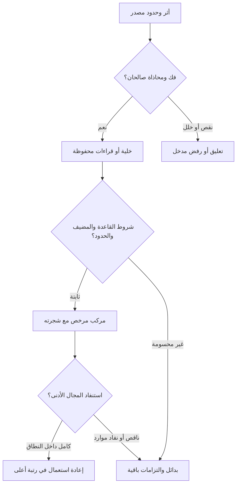

# الدال وحده: سلسلة القرار ومنهج التعلم في NABT

تدقيق وتطوير على الأصل `9c7cf0d0c3791285d201790f7468ef78de45ccda`، 2026-11-04.
عقد القبول السابق للتنفيذ: [SIGN_CURRICULUM_ACCEPTANCE_AR.md](SIGN_CURRICULUM_ACCEPTANCE_AR.md).

**القرار:** نبني الدال بوصفه موضوع معرفة لغوية: أثر مضبوط، وهوية، وقراءات
صوتية وصرفية وتركيبية، مع شروط ومصادر وبدائل. لا يجعل عدّ الخلايا وظيفة
الحرف معلومة؛ ولا تجعل مطابقة قالب لفظًا بعينه مصدرًا أو فعلًا.
أضيف مستهلك تعليمي داخل `tools/arabic_training` يستعمل المالكين القائمين،
ومقياسًا لمجموعة تطوير معلنة. لم تُغيّر لغة قبول النواة أو تُنشأ نواة أخرى.

## 1. تطبيق الطريقة العقلية على الدال

راجعنا [التفكير، طبعة 2021](https://www.hizb-uttahrir.info/ar/files/PDFs/Book_Ar/alTafkeer_08.11.2021.pdf)،
خصوصًا ص20–23، ومواضع التفكير في النصوص ص102–111. يميز النبهاني الواقع
المحسوس والمعلومات السابقة وعمل الربط والحكم، ويفصل المعلومات السابقة
عن الرأي السابق المتسلط على البحث. ويميز معرفة الألفاظ والتراكيب من
المعرفة اللازمة لإدراك مضمون الفكر. هذه إحالة إلى تصوره؛ لا دعوى بأن
تعريفه الفلسفي برهان لصحة برنامج أو نموذج عصبي.

الترجمة الهندسية المقترحة، وهي من تصميم هذه الدراسة، تكون لكل مسألة:

| العنصر | تطبيقه في الدال | مثال الخطأ الذي يمنعه |
|---|---|---|
| موضوع البحث | وقوع مكتوب أو تسجيل معين، وحدوده والسؤال عنه | سؤال عن حركة غير مرصودة وكأنها معلومة |
| المعطى | البايتات الأصلية، أو عينات الصوت وخصائص تسجيلها | مساواة رقم Unicode بموجة صوتية |
| المعلومات السابقة | تعريف الأبجدية، قواعد النطق والصرف والنحو، شواهد المعجم | وضع الجواب المتوقع في مدخلات الحالة |
| الربط | شاهد انطباق القاعدة على المضيف والموضع والحدود | اعتبار كل تاء بادئة حرف مضارعة |
| الحكم | قراءة مرخصة داخل نطاق معلوم، أو بدائل، أو تعليق | اختزال الجهل أو نفاد الموارد إلى رفض العربية |
| المراجعة | ما الذي يبقى أو يسقط عند تغير الشاهد | إسقاط حكم له دعم مستقل لم يسحب |

التدريب يبدأ من الواقع اللغوي نفسه؛ لا نستعمل اللغة مجرد قناة لأوامر
برمجية. لكن الفصل بين الدال والمدلول **فصل لموضوع التدريب ومستوى الدعوى**:
اسم «نافية» أو «موصولة» يتضمن معرفة بوظيفة لغوية، وتعيينه قد يحتاج سياقًا.
نسمي هذا وظيفة الدال المشروطة، ونؤجل تعيين الشيء الخارجي وصدق القضية
والتطبيق على الواقع. لا نعلن أن جميع الوظائف قابلة للاستخراج من الرسم وحده.

## 2. ما كشفه فحص الشيفرة الفعلية

نجح فهرس إعادة الاستعمال في مطابقة مصادر الفهرس المجمّع الحالي: 82 وحدة
صورية و1605 تصريحات معلنة و39 عائلة. سجل 51 التزام جسر مفتوحًا قبل هذه
الإضافة؛ هذا جرد إحالات، وليس تشغيلًا لكل قدرة. ونجح حل فهرس تنظيم القواعد.

| المالك الموجود | ما نستعمله | حد الاستعمال |
|---|---|---|
| `Cell / alphabet / codec` | 29 حاملًا، أربع حالات، العدد والإطار والوقوع | هوية قابلة للاستعادة، لا سماع ولا وظيفة |
| `Law / Machine / Transition` | الانتقال والأثر عبر حالات الدخول الـ97 | لغة الشكل المعلنة؛ `mode` يختار شرط النهاية |
| `UnitCarrier / LicensedDerivation` | إعادة استعمال المركب مع باطنه ومقدماته | لا تصبح الوحدة المركبة عضوًا جديدًا في `Fin 116` |
| `ProsodicUnits / BinaryUnitDomain` | ترتيب C/V والكمية والتقطيع والاستنفاد المحدود | التعداد لا يمنح الترتيب قبولًا لغويًا |
| `PhonologicalModes` | 20 شاهدًا و20 مقطع مصدر؛ بداية ونهاية مستقلتان | تحليل مؤلف للشواهد؛ ليس قارئ صوت أو نص حر |
| `AffixFunctions` | 34 وظيفة بمتطلباتها وأمثلتها | جرد معلن، وليس مصنفًا آليًا لكل وقوع |
| `PersonEvidence / Derivation / Words` | الشخص والقالب والقراءات المشروطة | أهلية الأسرة والمضيف والمعجم تظل لازمة |
| `RecursiveSourceBridge` | المصدر والوقوع والتحقيق وشروط الجسر | استعادة المصدر لا تعني `grammar_certified=true` |
| `RuleLearning / QualifiedInference / EvidenceLifecycleV1` | المرشح وشروط التطبيق والمراجعة | لا تستبدل اكتساب الشواهد أو اعتماد القاعدة |

شُغّل قارئا الكلمة والاشتقاق على 33 مدخلًا من عائلة الطلب، مع إعادة
فحص كل تقرير من نصه. أعاد قارئ الكلمة `DEFER` في المدخلات الـ33 داخل
معجمه وإطاره الحاليين. هذه نتيجة لهذين المنفذين على هذه المدخلات، وليست
حكمًا على كل مستهلك في NABT. مثال مفيد: اقترح قارئ الشكل لـ«ذَلِكَ»
القالب `past.I.i`، لكنه أبقى الصنف المعجمي معلقًا؛ واقترح وزن مصدر
لـ«بَيْتٌ/تَبْغٌ/تَمْرٌ» دون إثبات أنها مصادر. هذا الفصل يحمي النظام،
ويبين الحاجة إلى شاهد الصنف والمعنى المعجمي، لا إلى تسمية القالب جوابًا.

أظهر تشغيل `Machine` أن «بِ» تقبل شكليًا في `wasl` و`waqf` معًا.
ذلك **لا يرخص الوقف المستقل على حرف الجر المتصل**؛ هذا المالك لا يحول
الحركات في الوقف ولا يعرف أن الباء حرف جر في الوقوع. نستبقي حكم الشكل
ونضيف شرط المضيف وحدود التلفظ في الطبقة المختصة؛ لا نغيّر القانون صامتًا.

## 3. الضبط العددي: كل n يحتاج مجالًا

ترتيب NABT الهجائي لا يساوي ترتيب مخارج سيبويه ولا ترتيب SLGE. استعمل
الجسر الموجود عند تغيير الإحداثيات. الحامل الصوتي أو اسم الحرف أو الحرف
المطبوع أو اسم الوظيفة أشياء مختلفة، وإن كان لكل منها تمثيل عددي.

\[
a=4c+h,\quad 0\le c<29,\quad 0\le h<4.
\]

| العدد | معناه |
|---|---|
| `a` في `nabt.a116.v1` | خلية الحامل والحالة |
| `116*p+a` | رقم وقوع محلي داخل **مصدر ونسخة تحليل معينين** |
| `F(u)` | رقم تسلسل الخلايا وفق `Sequence/codec` |
| رقم شجرة | عنوان البانيات والأبناء والقواعد في الجبر العودي |
| رقم وظيفة | فهرس في جرد الوظائف ونسخته؛ ليس خلية A116 |

إذن طلب `n = حامل / حالة / موضع` متحقق في هوية الوقوع الموجودة، على
أن يحفظ المصدر والنسخة أيضًا. مثال: «تَ» خلية 8، ووقوعها في الموضع 2
رقمه المحلي 240. وقوع مماثل في مصدر آخر لا يساويه في الهوية الكاملة.

\[
F(\epsilon)=0,\qquad F(ua)=116F(u)+a+1.
\]

«بِ» خلية 6، ورقم سلسلة الخلية المفردة 7. «نَاْ» في الرسم الترميزي
الصارم خلاياه `[96,3]` ورقمها 11256. علامة السكون على الألف هنا صياغة
واجهة A116، وليست مطالبة بتغيير الإملاء المعتاد لـ«نا».

**29×4=116 خلية؛ وليست 116 مقطع CV منطوقًا.** الفتحة والضمة والكسرة
ثلاث حركات قصيرة، والسكون حالة. الخانات المتحركة 87، ومنها ثلاث للألف
المتحركة يرفض قانون الشكل وقوعها؛ فيبقى 84 مرشح CV. الخانات الساكنة 29
محفوظة؛ منها ما يحقق صامتًا، ومنها حامل مد بشروط المجانسة والسياق.

قوالب CVV الـ84 هي 28 صامتًا × ثلاثة أنواع مد. لا تعني 84 كلمة مستعملة
أو 84 وظيفة نحوية. وتبقى الواو والياء صامتين في مواضع أخرى؛ «بَيْت» لا
يُقرأ مدًّا طويلًا لمجرد وجود الياء. كما أن VV إسقاط قد يساوي بين حركة
طويلة وحركتين قصيرتين؛ تحفظ `ProsodicUnits` هذا الفرق في نوع الكمية.

### جدول الحوامل وأسماء الحالات ومجال الخلايا الكامل

الأعمدة هي الفتحة والضمة والكسرة والسكون بهذا الترتيب؛ اسم كل خلية هو
«اسم الحامل / اسم الحالة». تشمل المصفوفة التنفيذية الاسم والرسم والبتات
ورقم التسلسل وأثر كل حالة دخول وحكم الشكل، ولا تحذف الخانات المرفوضة.

| الحامل | اسمه | فتحة | ضمة | كسرة | سكون |
|---|---|---:|---:|---:|---:|
| ا | ألف | 0 | 1 | 2 | 3 |
| ب | باء | 4 | 5 | 6 | 7 |
| ت | تاء | 8 | 9 | 10 | 11 |
| ث | ثاء | 12 | 13 | 14 | 15 |
| ج | جيم | 16 | 17 | 18 | 19 |
| ح | حاء | 20 | 21 | 22 | 23 |
| خ | خاء | 24 | 25 | 26 | 27 |
| د | دال | 28 | 29 | 30 | 31 |
| ذ | ذال | 32 | 33 | 34 | 35 |
| ر | راء | 36 | 37 | 38 | 39 |
| ز | زاي | 40 | 41 | 42 | 43 |
| س | سين | 44 | 45 | 46 | 47 |
| ش | شين | 48 | 49 | 50 | 51 |
| ص | صاد | 52 | 53 | 54 | 55 |
| ض | ضاد | 56 | 57 | 58 | 59 |
| ط | طاء | 60 | 61 | 62 | 63 |
| ظ | ظاء | 64 | 65 | 66 | 67 |
| ع | عين | 68 | 69 | 70 | 71 |
| غ | غين | 72 | 73 | 74 | 75 |
| ف | فاء | 76 | 77 | 78 | 79 |
| ق | قاف | 80 | 81 | 82 | 83 |
| ك | كاف | 84 | 85 | 86 | 87 |
| ل | لام | 88 | 89 | 90 | 91 |
| م | ميم | 92 | 93 | 94 | 95 |
| ن | نون | 96 | 97 | 98 | 99 |
| ه | هاء | 100 | 101 | 102 | 103 |
| و | واو | 104 | 105 | 106 | 107 |
| ي | ياء | 108 | 109 | 110 | 111 |
| ء | همزة | 112 | 113 | 114 | 115 |

أسماء الحروف ألفاظ مركبة هي الأخرى: اسم «باء» ليس الرمز «ب»، وليس
مقطعه «بَ». نحتفظ بعلاقة **اسم الخلية ← هويتها** بوصفها معلومة تعريفية؛
لا نستنتج تحليل لفظ الاسم من عدد الحرف الذي يسميه.

## 4. من البتات إلى المخارج: فرعان يلتقيان بشاهد

في النص: بايتات UTF-8 ← محارف ← وحدات رسم مع مواضعها ← قراءات مرشحة
← تفسير صوتي. وفي التسجيل: عينات صوت وبيانات جهاز ← مقاطع زمنية
وملاحظات صوتية ← مرشحو فونيمات. لا ينشأ المخرج الفيزيائي من البتات
بمعادلة الترميز؛ يحتاج ربط القناتين إلى محاذاة وتسجيل وتقييم مستقل.

الجرد الحالي يصف مخارج الحوامل وصفاتها في ملف اصطلاح **سيبويه**. لا
يساوي تلقائيًا بين «مجهور» عنده وسمات IPA الحديثة، ولا يخلط عدّه
للمخارج الستة عشر بعدّ آخر. النون الخفيفة في الخياشيم حالة موصوفة؛
ليست حرفًا أصليًا ثلاثين يوسع `Fin 29`.

توجد مشكلة مصدر حقيقية: تفريغ OpenITI المثبت يسقط فصل مخرج اللام عن
النون. تبقى اللام والنون `PENDING_LAM_NUN_LACUNA` في المصفوفة، مع بقاء
الصفات التي يشهد بها النص مستقلة عن هذا السقط. توجد قراءة متابعة في
[نص الكتاب، ج2 ص489 في هذه الطبعة](https://books.rafed.net/view/2564/page/489)
وفي [شرح السيرافي، ج5 ص391](https://shamela.ws/book/17726/2395)،
ونسخة [مصورة للجزء الرابع](https://d1.islamhouse.com/data/ar/ih_books/chain_01/Ktab_Sibouih/ar_04_ktab_sibouih.pdf).
لم تُعتمد هذه الروابط تصحيحًا بايتيًا للنسخة المثبتة أو تحققًا بصريًا
مكتملًا في هذه الدفعة. لا يجوز ملء الفجوة ثم احتسابها تعلمًا أو شاهدين مستقلين.

## 5. سلسلة القرار المتدرجة



لكل انتقال بطاقة: المدخل الأصلي، المخرج، مجال الرقم، هوية القاعدة
ونسختها، شروطها وموانعها، شواهد تحققها في هذا الموضع، المضيف، حدود البدء
والانتهاء، البقايا، البدائل، وطريقة إعادة الفحص. علاقة البناء المستهدفة:

\[
\mathcal U_{r+1}=\mathcal U_r\cup
\{f_\rho(u_1,\ldots,u_k):u_i\in\mathcal U_r,
\ \text{تحققت واجهات }\rho\text{ ومقدماتها وتحقيقها}\}.
\]

هذه قراءة تنظيمية للبانيات الموجودة، لا تعريف نواة جديدة. يكون المركب
حاملًا في المرحلة الأعلى مع الاحتفاظ بأبنائه؛ لا تُمسح شجرته في رقم.
الاستنفاد يتعلق بمجال محدد وبنسخة نحو ومعجم وحدود موارد معلنة. لا يمكن
جعل «كل استعمالات كل CV في العربية غير المحدودة» شرطًا منتهيًا قبل
تعلم أي كلمة؛ يحتاج تعلم دور التاء نفسه إلى شواهد من كلمات. لذلك يفصل
المنهج **إغلاق هوية الطبقة الأدنى** من **استكمال وظائفها داخل مجال التدريب**،
ويستخدم المضيف كشاهد للسمة، دون منح كل مركب جديد ترخيصًا مجانيًا.

## 6. قوانين الابتداء والوصل والوقف وتقطيع المقاطع

يلزم فصل ثلاثة محاور: أول الملفوظ/وسطه، أول الكلمة/وسطها/آخرها، وموضع
المورفيم من الجذع. قد تكون التاء أول الفعل داخل «وَتَضْرِبُ» وليست أول
الملفوظ. بداية الكلمة `ibtida|wasl` ونهايتها `wasl|waqf` مستقلتان؛
يمكن الابتداء بالكلمة والوقف عليها في التجربة نفسها.

| شكل المقطع | الوصف | وضعه في المنهج |
|---|---|---|
| CV | قصير مفتوح | صامت وحركة قصيرة؛ الوظيفة وشروط استقلال الكلمة لاحقة |
| CVV | طويل مفتوح | حركة طويلة واحدة ومجانسة حامل المد؛ لا VV مجردة |
| CVC | مغلق قصير | حركة قصيرة وصامت ختامي؛ الوصل قد يعيد التقطيع |
| CVVC | مديد مغلق | يجب إدراجه؛ يشهد في الوقف، وله سياقات وصل خاصة كالمشدد |
| CVCC | مغلق بصامتين بعد قصيرة | من صور الوقف في الملف المعياري؛ ليس ترخيصًا لكل زوج صوامت |
| CVVCC | مغلق بصامتين بعد طويلة | مجال وقفي مقيد؛ التشديد والتحليل الصوتي لازمان |

هذا **تصنيف أهداف لغوية**، وليس جدول قبول لكل لهجة ورواية. الخاص في
الوصل يحتاج نص قاعدته؛ لا تُحوّل ملاحظة شائعة إلى منع كلي. عند التقاء
الكلمتين تحفظ الهمزة القطعية، وتسقط همزة الوصل حيث يتحقق شرطها، ويفحص
التقاء الساكنين والتحريك العارض وحذف حرف المد والإدغام بشواهد مستقلة.
وعند الوقف يفحص نوع النهاية: حركة، تنوين، تاء مربوطة أو مبسوطة، معتل،
ضمير وصلته، هاء سكت، والخيارات المنقولة كالروم والإشمام في ملفها.
الإشمام ليس حذف حركة في نص؛ يحتاج وصفًا أو مشاهدة ملائمة لقناته.

الوقف لا يمحو الأصل النحوي: «كَتَبْتَ» و«كَتَبْتِ» قد تتفقان في
الإسكان الوقفي، فيبقى رسم كل منهما وتحليله. وإذا لم يكن لدينا إلا
الصوت الوقفي المشترك فلا نسترد منه جنس المخاطب يقينًا.

للوصل العددي نستعمل أثر القطعة الكامل على الحالات الـ97، ثم نمرر حالة
خروج الجزء الأول مدخلًا للثاني. قبول كل جزء منفردًا من الصفر لا يثبت
قبول وصلهما. هذا مبرهن ومختبر في `UnitCarrier`؛ يُعاد استعماله هنا.

## 7. كيف تدرّس عائلة التاء ثم تعمم الإجراء؟

| الوقوع | المطلوب اكتسابه | شاهد الترخيص والمانع |
|---|---|---|
| بِـ | مرشح حرف جر متصل | مضيف اسمي وتعلّق وحدود؛ وجود الباء في بِنْت لا يحققها |
| تَاللَّهِ | تاء قسم | قراءة القسم ومجال مدخول التاء؛ ليس أي اسم أو أي تاء مفتوحة |
| تَضْرِبُ | حرف مضارعة | أسرة فعلية وتطابق الصيغة؛ يحتمل مخاطبًا مذكرًا أو غائبة مؤنثة |
| وَتَضْرِبُ | واو ووظيفة تاء داخل فعل | تفكيك اللصيق والمضيف وإعادة فحص الوصل؛ وظيفة الواو لا تحسم من شكلها |
| كَتَبْتُ/كَتَبْتَ/كَتَبْتِ | ضمير رفع متصل | الماضي وتصريفه وسمات الشخص المرتبطة؛ ليس مجرد تاء في آخر الرسم |
| كَتَبْتُمْ | صيغة جمع المخاطبين | تحليل صيغة الضمير/علامة الجمع بحسب القانون؛ ليست «تَ» نفسها لكل شخص |
| كَتَبَتْ | تاء التأنيث | علامة اتفاق، لا ضمير الفاعل السابق |
| تاء في تُفَّاح/بَيْت/تُرَاب/تَبْغ/تَمْر | موقع في الجذع | شاهد معجمي وقالب؛ لا تستنتج أصل الجذر أو الزيادة من الحرف وحده |

«تَ» في آخر «كَتَبْتَ» هي **آخر الكلمة في الوصل**؛ تسميتها «تاء
مفتوحة بالوقف» تخلط المحورين. وكذلك تحتاج التاء المضمومة «تُ»، والتاء
الساكنة «تْ»، والشدة، والأمر المؤنث، ونون النسوة والتوكيد إلى أمثلة
مستقلة. لا تنقل تسمية واحدة إلى جميع خلايا التاء الأربع.

ثم نكرر **إجراء جمع الشواهد والمقابلات والموانع** لكل خلية، لا قائمة
وظائف التاء نفسها لكل حرف. توجد خلايا لا تؤدي وظيفة مورفيم مستقل؛
وظيفتها في وقوع معين خانة جذر أو قالب أو نهاية صوتية. اكتمال الصف يعني
تسجيل هذا الوضع ضمن مجال معلوم، لا اختراع وظيفة لسد كل خانة.

في CVV: «لا» لها قراءات نافية وناهية وغيرها، و«لا» في بداية «لاعب»
ليست الأداة. «ما» قد تكون نافية أو موصولة أو استفهامية أو غير ذلك.
«نا» تكون للرفع أو النصب أو الجر بحسب المضيف، ولا تكون ضميرًا في
«نار». مصدر هذه الفروق تعليم وظيفي مؤلف، ثم نختبر اكتساب قرائنها
على أسر جديدة؛ لا يكفي عرض الأسماء على الوكيل.

## 8. استكمال مجال المفرد والتركيب الذي يحتاجه الطلب

1. **الرسم والصوت:** همزة الوصل والقطع وصور الهمزة، الألف المقصورة،
   التاء المربوطة، الألف الخنجرية والفارقة، اللام الشمسية، الشدة والتنوين،
   الحروف المكتوبة غير المنطوقة والمنطوقة غير المكتوبة، ونقص التشكيل.
   عدد المحارف لا يساوي عدد الصوامت أو المقاطع.
2. **الأصول والجذوع:** ثلاثي ورباعي الفعل، وثلاثي ورباعي وخماسي الاسم؛
   الإلحاق والمضعف والمهموز والمثال والأجوف والناقص واللفيف، والإعلال
   والإبدال والقلب والنقل والحذف. لا نفرض جذرًا ثلاثيًا على كل مبني
   أو دخيل، ولا نحصر السطح في أربعة صوامت أو ست وحدات V.
3. **الاسمية:** الجامد والمشتق، مصادر الأبواب والسماعي منها، الميمي
   والصناعي واسم المرة والهيئة، الفاعل والمفعول والمبالغة والصفة المشبهة
   والتفضيل والآلة والزمان والمكان، التصغير والنسبة؛ المفرد والمثنى
   وجموع السلامة والتكسير واسم الجمع واسم الجنس؛ الجنس اللفظي غير الحقيقي.
4. **الفعل:** الماضي والمضارع والأمر، المجرد والمزيد، المعلوم والمجهول،
   اللزوم والتعدي وعدد المفاعيل، الجامد والمتصرف والناقص، الشخص والعدد
   والجنس، نونا النسوة والتوكيد، الأفعال الخمسة وحذف النون، حذف حرف العلة.
   زمن الصيغة غير وقت الحدث في المقام؛ المصدر لا يحمل زمن الفعل تلقائيًا.
5. **الأدوات والمبنيات:** الضمائر، أسماء الإشارة والموصول والاستفهام
   والشرط، أسماء الأفعال والأصوات والظروف، والروابط المتصلة والمنفصلة
   وأنواع النفي والاستثناء والحصر. الواو وأو لا تتحولان آليًا إلى بوابات منطقية.
6. **التركيب:** «بيت المال/عبد الله/رأس المال» إضافي؛ «حضر زيد» إسنادي؛
   «بعلبك/حضرموت» من المركبات المزجية في مجالها. «هذا/ذلك/تلك/الذي/التي»
   لا تعامل كلها تركيبًا مزجيًا منتجًا؛ تحليلها يرجع إلى أبوابها. الرسم
   المعياري «ذلك»، و«بعلبك»؛ لا تُصحح مصادر المستخدم صامتًا.
7. **العامل والعلامة:** العامل الملفوظ والمقدر، التعدي والتعلق، النواسخ،
   التوابع، الإضافة، الحال والتمييز والمفعولات، الاستثناء، النداء، الشرط
   والجواب، حذف العامل أو المعمول، الأثر الأصلي والفرعي، الإعراب اللفظي
   والمحلي والتقديري والبناء، الممنوع من الصرف واستثناء أل والإضافة.
8. **بنية الخطاب:** مرجع الضمير والعائد، الاقتباس والإسناد إلى قائله،
   الفصل والوصل، الاستئناف والاعتراض، الحذف المستدل عليه، نطاق النفي
   والاستفهام والشرط، القوة الإنجازية والقرينة. يدخل المقام بقدر ما
   يرفع لبس البنية؛ صحة المرجع والخبر في العالم تبقى في المرحلة المناسبة.

«العوامل المئة» جرد بعينه لا مرادف لكل النحو؛ يراجع `AwamilInventory`
وعلاقته بقطر الندى وسيبويه والألفية صفًا صفًا. كذلك لا يكفي عد نسب
إسنادية وتقييدية وتضمينية؛ يلزم تعريف كل نوع: الإضافة ليست إسناد خبر،
والتضمين النحوي ليس دلالة التضمن المنطقية على جزء المعنى.

## 9. الاستقراء والتعلم والبرهان: مسؤوليات منفصلة متصلة

لكل باب: موضع الكتاب ونسخته، نص القاعدة وسياقها، قراءة اصطلاحها، أمثلة
إثبات، أمثلة قريبة لا ينطبق عليها الحكم، شروط وموانع، صاحب التنفيذ،
مقدمات المبرهنة، شاهد التطبيق، وشاهد إعادة الفحص. تحفظ القراءات المختلف
فيها والملفات اللهجية بوصفها ملفات معلنة، ولا يحسمها تصويت النموذج.

الاستقراء على الشواهد يكوّن مرشح قاعدة ويكشف المثال المضاد. والاستقراء
البنيوي في Lean يثبت حفظ خاصية عبر البانيات المرخصة. والاستنفاد يغطي
مجالًا محدودًا معلومًا. هذه عمليات مختلفة؛ نجاح واحدة لا يعوّض نقص
الأخرى. تبقى كل قاعدة كلية بحاجة إلى مستند اعتمادها في نطاقها.

طلبات 1..4C مع 1..6V تُصدر بوصفها 24 مجال حصص. عدد ترتيبات كل مجال
قبل الترخيص هو `binomial(C+V,C)`؛ 2C+2V يعطي ستة ترتيبات، وليس مقطعًا
واحدًا. يتولى `ProsodicUnits.quotaWords` التوليد الكامل في حدوده، ثم
يفحص الصوت والتقطيع والمضيف كل مرشح. ويضاف الخماسي الاسمي إلى مجال
الأصول؛ أما التركيب المتكرر فلا يغلق بحد اعتباطي لثلاثة مقاطع.

ينفذ `native-shapes` هذه المجالات الأربعة والعشرين عبر `progressiveUnitProbe`
الموجود، ويحتفظ بكل ترتيب ورقمه وجواب المنفذ كاملًا. يفحص طول القائمة
بمعامل ثنائي الحدين، وعدم التكرار، وصحة حصتي C/V لكل عنصر؛ اجتماعها يغطي
المجال المحدود كله. وينفذ الأشكال الستة وأرقامها أيضًا: CV=4، CVV=10،
CVC=9، CVVC=21، CVCC=19، CVVCC=43، في مجال `nabt.ordered-cv.v1`.
هذه الأعداد تختلف عن أرقام خلايا A116 وعن شواهد الترخيص اللغوي.

المتعلم العصبي المقترح يتعلم المحاذاة والسمات وترتيب التحليلات وقرائن
الوظيفة، ويحتفظ بالبدائل. فحص العدد والشروط المعروفة وشهادات المصدر
يبقى في المالك القائم. لا نعيد تدريب نموذج ليقلد قرارًا حسابيًا معلومًا
ثم نجعل تنبؤه بديلًا عن الفاحص.

## 10. منهج التدريب وبوابات العبور

| المرحلة | المهمة | القياس والبوابة |
|---|---|---|
| D0 | الإطار والبايتات والحدود | الاستعادة التامة؛ رفض التشوه وتعليق الناقص؛ 100% في المجال المحدود |
| D1 | الحامل والحالة والموضع | 116/116 هويات، أسماء، مصدر وموضع؛ لا حذف للخانات غير المرخصة وقوعًا |
| D2 | المخارج والصفات | دقة تصنيف لكل حرف ولكل صفة وملف؛ النص المعارض معلق؛ الصوت بمقام مستقل |
| D3 | الكمية والمقاطع الستة | تمييز C/حركة قصيرة/مد/سكون، ومحاذاة المصدر؛ قياس الحدود لا العدد وحده |
| D4 | بدء واتصال ووقف | فقد/زيادة الهمزة، نوع الحركة وطولها، بدائل الوقف، وحفظ الأصل |
| D5–D6 | الأصل والزيادة والوظيفة | استرجاع خانات الجذر واللواصق، الشروط المكتسبة، وحفظ غموض الشخص |
| D7–D8 | التصريف والمركبات | أسر جديدة؛ منع تسرب الجذر أو شكل آخر من الأسرة إلى الاختبار |
| D9 | العامل والنسبة والعلامة | شجرة وتحقيق كل شرط ومانع، مع الحذف والمقدر وحدود المقام |
| D10 | النقل والمراجعة والتفسير | يسقط المسار بسحب مقدمة لازمة ويبقى الحكم إذا بقي مسار كاف مستقل |

العتبة الحتمية 100% تخص الهوية والحراسة داخل المجال المستنفد. أما التعلم
اللغوي فلا نختزل جاهزيته في رقم إجمالي اعتباطي: نفصل الاسترجاع الصحيح،
والقبول الخاطئ، والرفض الخاطئ، والتعليق الصحيح، واستبقاء البدائل، ونسبة
الشروط المكتسبة فعلًا. يُجمّد حجم الاختبار وأسرته وعتباته قبل التدريب.
إذا شوهد صفر خطأ في N حالة فلا يعني ذلك صفر خطر عام؛ حد تقريبي أعلى
95% لمعدل الخطأ هو 3/N تحت فرض عينة مستقلة ممثلة، وليس برهانًا لغويًا.

التقسيم المطلوب: تدريب/تطوير/اختبار بحسب **الأسرة الجذرية، والمقطع
المصدري، ونوع التحول**، ومع الصوت بحسب المتكلم والجلسة أيضًا. لا توضع
«كتب/يكتب/اكتب» في أقسام مستقلة ثم تسمى الجديدة تعميمًا إلى جذر مجهول.
تأتي حالات النقل من شواهد أخرى ويضيف المقيم أمثلة مضادة بعد تجميد النموذج.

دورة التعلّم: نص جديد ومصادره → مخرجات المتعلم دون وسوم الجواب →
اقتراحات مرتبطة بمواضعها → فحص المالك وشروطه → تقييم مستقل → مثال مضاد
أو سحب شاهد → إعادة حكم مع حفظ البدائل. تستخدم `RuleLearning` للمرشحين
حين تكون لغة السمات المحدودة ملائمة، والجسور القائمة لتحصيلها؛ لا يعطى
المتعلم وسم «هذا ضمير» باعتباره شاهد تطبيق للحالة التي يُختبر عليها.

## 11. ما نفذ في هذه الدفعة وكيف يعاد تشغيله

من جذر نسخة المستودع، دون حاجة إلى نموذج خارجي:

```bash
mkdir -p artifacts/local/sign-curriculum
PYTHONPATH=src python -m tools.arabic_training.sign_curriculum matrix --output artifacts/local/sign-curriculum/matrix.json
PYTHONPATH=src python -m tools.arabic_training.sign_curriculum questions --output artifacts/local/sign-curriculum/questions.json
PYTHONPATH=src python -m tools.arabic_training.sign_curriculum self-check --output artifacts/local/sign-curriculum/self-check.json
PYTHONPATH=src python -m tools.arabic_training.sign_curriculum probes --output artifacts/local/sign-curriculum/probes.json
PYTHONPATH=src python -m tools.entropy_framework reuse --run sign-curriculum -- questions
```

الكتابة ترفض استبدال ملف موجود. استعمل مسار تشغيل جديدًا للإعادة.
الأسئلة لا تحتوي أجوبتها؛ لكنها مجموعة تطوير علنية يمكن الاطلاع على
مرجعها، فلا تسمى اختبارًا محجوبًا. تتكون من 116 هوية، و84 كمية طويلة،
و160 تركيب حدود للشواهد العشرين، و8 ضوابط مدخلات: **368 سؤالًا**.
الـ160 ليست 160 شاهدًا أصليًا مستقلًا.

ملف توقعات النموذج أو الوكيل له الحقول المحددة في `prediction_schema`:
`schema/suite_sha256/predictor/answers`، ولكل جواب `id/value`. ثم:

```bash
PYTHONPATH=src python -m tools.arabic_training.sign_curriculum evaluate --predictions answers.json --output evaluation.json
```

يعاد فتح المصادر وفحص بصماتها وإنتاج المرجع. يحسب الفاحص الغائب ضمن
المقام الأصلي، ويرفض تكرار الهوية وتغيير المجموعة والحقول التي تزعم
السلطة. يفصل `false` عن `0` و`0.0` عن `0`، ويكشف إسقاط بديل وقفي صحيح.
النجاح يعيد `symbolic_suite_pass=true` فقط؛ يبقى
`meaning_stage_unlocked=false` و`learning_established=false`.

هذا مستهلك للمستودع تحت `tools/`، وليس أمرًا إضافيًا مثبتًا في حزمة
`nabt-machine`. صار منفذه ظاهرًا في `reuse` ليستعمله وكيل إدارة المهام.
الوكيل الإداري الحالي لا يتحول بهذا التسجيل إلى نموذج يتعلم من ذاته؛
يلزم إرفاق تشغيل المتعلم وهويته وبياناته وتوقعاته ليقاس تعلمه.

في البيئة التي بُني فيها المنفذ الأصلي:

```bash
cd formal
lake build unitDiscoveryProbe progressiveUnitProbe exportPhonologicalModes
cd ..
PYTHONPATH=src python -m tools.arabic_training.sign_curriculum native-check
PYTHONPATH=src python -m tools.arabic_training.sign_curriculum native-shapes --output native-shapes.json
python tools/check_phonological_modes.py
PYTHONPATH=src:tests python -m unittest test_sign_curriculum -v
```

`native-check` يرسل طلب JSONL إلى `unitDiscoveryProbe` الموجود ويقابل
الوظائف الـ34 ومتطلباتها وأمثلتها بالفعل؛ والفاحص الصوتي القائم يقابل
72 مفتاح تحكم و160 تركيب حدود بين Python وLean. هذا تطابق محدود عند
حدود تنفيذ فعلية، وليس برهان تنقيح عام ولا برهان صحة التفسير المؤلف.

## 12. شرط الانتقال إلى المدلول

لا يفتح عدّ 116 أو نجاح المجموعة الرمزية مرحلة المدلول. يلزم أولًا
مجال دال محدد ومتصل: معجم/نحو وملف صوتي معلوم، محاذاة كاملة، قراءات
مرخصة محفوظة، شروط مكتسبة من المصدر لا ملقنة للحالة، شاهد تطبيق الجسر،
مراجعة صحيحة عند سحب الأدلة، ونتائج على أسر وشواهد مستقلة. يعلن ما بقي
من النص أو التسجيل غير مفسر، ولا يختفي في متوسط النجاح.

عندئذ يبدأ «المدلول وحده» بتعريف الأجناس والخواص والعلاقات ومصادرها،
ثم يختبر «الدال والمدلول معًا» أمانة الإحالة والتفسير. هذه بوابات نطاق
بحثي معلوم؛ لا تعني استنفاد كل كلام عربي ممكن قبل بدء دراسة المعاني.

مراجع التكامل: [الأساس](NABT_FOUNDATION_REUSE_AR.md)،
[الوحدات المتدرجة](PROGRESSIVE_UNITS.md)، [تدقيق وظائف الوحدات](UNIT_DISCOVERY_SOURCE_AUDIT.md)،
[الحدود الصوتية](PHONOLOGICAL_MODES.md)، [معمارية العربية](LINGUISTIC_ARCHITECTURE_STUDY_AR.md)،
[جسر الاشتقاق](DERIVATION_SURFACE_V1_AR.md). الشواهد الثلاثة يحتفظ بها
المستودع مع نسبتها ورخصتها في `src/nabt/data/source_evidence/source_manifest.json`؛
المصفوفة تصدر الإحالات والحدود، ولا تعيد نسخ الكتب أو تدعي اكتمال استقرائها.
