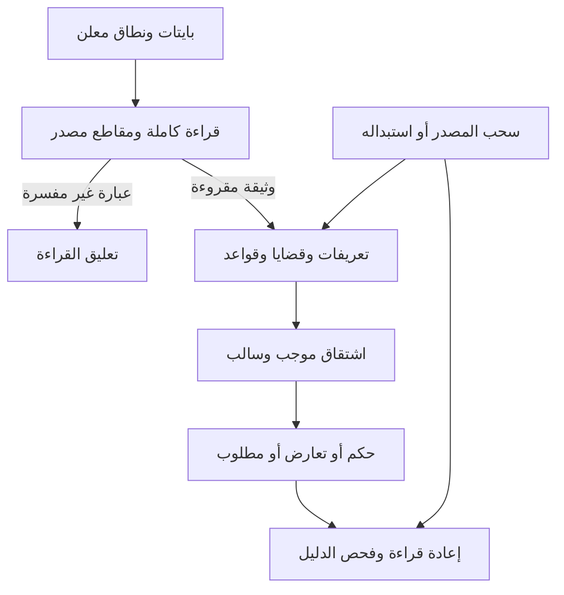

# من النص إلى القضية ثم الحكم والمراجعة

## ما أُكمل في `0.4.0a1`

يبني المسار الجديد داخل NABT تعريفات وخواص وعلاقات وقواعد من **النص المدخل**،
بأسماء لم تُدرج في قاموس أمثلة. كانت واجهة التعلم السابقة تعتمد على تسعة
سجلات مصدر معروفة بسياسة قراءة محددة. الواجهة الجديدة تستقبل بايتات جديدة،
وتستخرج منها تمثيلًا وفق `nabt.controlled-arabic.v1`، ثم تجيب عن قضية جديدة
وتحفظ الدليل أو المطلوب، وتعيد الحساب عند استبدال مصدر أو سحبه.

القارئ يقبل لغة محددة مصرحًا بقواعدها. لا يثبت هذا الإصدار استخراج المقصود
من كل نص عربي، ولا يوحّد معنى كل لفظ مشترك أو يكتشف المجاز والضمير المحذوف.
نتائج القراءة على النصوص المضبوطة وعلى مقاطع الكتب الأصلية منشورة منفصلة
في [تقرير القياس](TEXT_EVALUATION.md).

## الأجزاء المنفذة

| الملف | العمل الذي يؤديه |
|---|---|
| `src/nabt/text_reader.py` | تقسيم كامل لبايتات الوثيقة؛ قراءة التصريح والتعريف والخبر والنفي والشرط والسؤال؛ مقاطع مسماة لما بقي دون قراءة |
| `src/nabt/text_ir.py` | قضايا أحادية وثنائية، ووقائع وقواعد وتعريفات، ومصدر ومجال وهوية تحليل ومقاطع لكل عنصر |
| `src/nabt/semantics.py` | ربط المتغيرات، الاشتقاق، كشف الدعمين المتعارضين، اختيار اشتقاق خالٍ من المقدمات المتعارضة، خطط استكمال مفحوصة، ومراجعة المصادر |
| `src/nabt/program.py` | ترجمة أحداث النص إلى تعليمات مرقمة، وتنفيذها، وحفظ سجل يعاد تشغيله للتحقق منه |
| `formal/Nabt/SemanticInference.lean` | مواصفة الاستدلال وسلامة شهادة الاشتقاق في مجالها، مع افتراضات الترخيص ظاهرة |
| `formal/Nabt/Program.lean` | هوية أرقام التعليمات وسلامة مجالاتها؛ فصل برنامج النظرية النصية عن برامج الصيغ والتعلم |



## المثال الكامل

المادة في `examples/text_theory.txt`:

```text
تعريف باحث هو شخص و مدقق.
علاقة يراجع.
إذا ?س هو باحث و ?س يراجع ?ص فإن ?ص هو مفحوص.
سالم هو شخص.
سالم هو مدقق.
سالم يراجع تقرير.
```

السؤال `هل تقرير هو مفحوص؟` يتطلب ربطًا متعدد الخطوات:

1. يقرأ التعريف المحلي: الباحث يجمع صفة الشخص وصفة المدقق، في الاتجاهين
   اللذين يجيزهما هذا القالب. صيغة `كل باحث هو شخص` لا تمنح الاتجاه العكسي.
2. يثبت `باحث(سالم)` من المقدمتين الواردتين ومن قاعدة التعريف.
3. يربط متغيري القاعدة بـ`سالم` و`تقرير` ويستعمل العلاقة الواردة في النص.
4. ينتج `مفحوص(تقرير)` مع ترتيب مقدماته ومقاطع القواعد والشواهد.

لا يوجد فرع في البرنامج خاص بكلمات «باحث» أو «سالم» أو «تقرير». تأتي هذه
الأسماء من النص. لكل لفظ كتابته الدقيقة؛ اختلاف الحركة أو Unicode لا يُسوّى
إلى تطابق دلالي دون قانون آخر.

في `examples/text_inquiry_revision.json` تُفصل المصادر ثم تُسحب مقدمة
`مدقق(سالم)`، فيصير الجواب `UNKNOWN` ويُحسب ما ينقصه. تعاد المقدمة فيعود
الدعم. تضاف مقدمة سالبة لنفس القضية فيصير سؤالها `CONFLICT`، ويتوقف الحكم
المعتمد عليها بسبب `CONTESTED_PREMISES`. ثم يُحل سؤال لشخص ومادة مختلفين
باستعمال القواعد نفسها دون تعديل الشيفرة.

هذه تجربة بناء معلنة. لا تدخل أعداد نجاحها في القياس المحجوب المستقل.

## كيف يحمل الرقم المعنى دون أن يمنحه الصدق

القضية المستعملة في الاستدلال هي:

\[
q=(\text{scope},\text{predicate},(a_1,\ldots,a_k),\text{polarity}),\quad k\in\{1,2\}.
\]

يُعطى هذا السجل عددًا قابلًا للعكس من UTF-8 معياري، مع مساحة أسماء وإصدار
وبادئة تحفظ الطول. يرفض المفكك الأعداد غير المعيارية أو التابعة لمجال آخر.
هذا رقم **القضية المقيدة**، منفصل عن رقم سلسلة A116 وعن رقم البرنامج.
وظيفته حفظ الهوية الرياضية، ولا يكون وجود الرقم دليلًا على صحة القضية.

كل قاعدة تحدد جسمًا ورأسًا، وتربط المتغير نفسه بالقيمة نفسها في جميع
مقدماتها. كل متغير في النتيجة يجب أن يظهر في مقدماتها. لا تنشأ فردية شيء
بمجرد التصريح بتعريف؛ ولا يثبت النفي من غياب خبر موجب.

للبرنامج أرقام التعليمات التالية، مضافة إلى ABI القائم:

| الرقم | العملية | الأثر |
|---:|---|---|
| 30 | `START_TEXT` | إنشاء نظرية ضمن مجال معلوم صالح |
| 31 | `ADD_TEXT` | إعادة قراءة المصدر الجديد وإدخاله كاملًا أو إبقاء النظرية السابقة |
| 32 | `REMOVE_TEXT` | سحب المصدر وإعادة حساب ما فقد سنده |
| 33 | `QUERY_TEXT` | قراءة السؤال ثم إنتاج الحكم والدليل أو السبب |
| 34 | `REPLACE_TEXT` | استبدال صريح لهوية مصدر قائمة؛ الفشل لا يحذف المصدر السابق |

لا تتلقى هذه التعليمات حقول `trusted` أو `facts` أو `proof` تمنح المحتوى
سلطة. تحوي التعليمة بايتات المادة، ويقوم القارئ والفاحص المركبان ببقية العمل.
إذا توقف التنفيذ على مدخل فاسد يحتفظ السجل بحالة المصادر الفعالة. إعادة
الفحص تقارن البرنامج والنتيجة والسجل والعقود وبصمات التنفيذ، ولا تكتفي ببصمة
يقدمها صاحب المحتوى.

## ما يعنيه الحكم

| الحالة | الدلالة المحددة |
|---|---|
| `SUPPORTED` | للسؤال اشتقاق لا يستعمل قضية لها دعم ونفي داخل النظرية الحالية |
| `REFUTED` | لنقيض السؤال اشتقاق من النوع نفسه |
| `CONFLICT` | ثبت الدعم الموجب والسالب للقضية في الإغلاق الموقع |
| `UNKNOWN` | لا يوجد اشتقاق لأي من الجانبين؛ تظهر خطط إضافات مفحوصة إن وجدت |
| `OUT_OF_SCOPE` | محمول السؤال أو عدد حججه غير معرّف في هذا المجال |
| `DEFER` | تعارض في مقدمات الاشتقاق، أو قراءة غير مدعومة، أو حد موارد مسمى |

هذه الحالات تتعلق **بما يجيزه النص تحت القراءة المركبة**. يبقى
`world_truth=NOT_ESTABLISHED` في جميعها. لا يثبت تنفيذ قاعدة شرطية أن نصها
صادق خارجيًا، ولا يمنح شاهدًا مكررًا استقلال مصدر جديد.

المطلوب المحسوب في هذا المسار أوسع تركيبًا من الصيغة الموجبة القديمة، لكنه
لا يرث تلقائيًا مبرهنة شمول `Nabt.Obligations`. يُولد بحثًا خلفيًا محدودًا
داخل قواعد ومجال أفراد معلومين. ثم يُجرب كل بديل افتراضيًا ويُبقى فقط ما
ينتج دعمًا نظيفًا للسؤال. هذه الفروض لا تُسجّل وقائع ولا تُصدر لها شهادة
مصدر. وقد يكون البحث غير مكتمل أو يتجاوز موارده؛ لا يتحول ذلك إلى نفي عام.

## صلة البناء بالمستودعات السابقة

استُعملت النسخ المثبتة في `INTEGRATION.md`، وفُحصت مواضعها مباشرة:

| الأساس السابق | ما بُني عليه داخل NABT |
|---|---|
| Mashru: `Aql/Qaida.lean`، و`Madlul/Dalala.lean`، و`Madlul/Shabaka.lean` | قاعدة مرخصة، هوية اشتقاق، علاقات ذات أطراف، ومنع التزام بلا شاهد |
| Mashru: `Jisr/MantuqMafhum.lean`، و`Aql/Idaa.lean` | حفظ المنطوق الذي استند إليه الاستنتاج؛ فصل النص عن برهان مطابقته للواقع |
| Alghanem: `QiraaMadlul.lean`، و`Haqaiq.lean` | قراءة محددة المجال؛ عدم تحويل غياب القراءة إلى معنى مخمّن |
| أرشيف Alghanem الدلالي المعلّق | عقود الفرق بين المحتوى والإسناد والمراجعة؛ أعيد تنفيذها محليًا، ولم يعتمد الأرشيف نواة تشغيلية |
| Qeyas: سند الخاصية وإعادة القراءة والمراجعة | استعمال `SourceBlob` و`SourceSpan` المحليين؛ إعادة الاشتقاق من المادة بدل قبول سجل جاهز |
| Taaqol-GPT والدال والمدلول والحامل | حفظ الهوية والبدائل، وفصل هوية الترميز عن سلطة المعنى والحكم |

توثيق الملفات وبصماتها وحدود نقلها في [عقد القارئ](TEXT_READER.md)
و[عقد الاستدلال](SEMANTICS.md). فهرس 4,231 تصريحًا سابقًا لا يعني أن جميعها
أُدخلت أو أعيد برهنتها. كل جزء معتمد في NABT له تعريف محلي واختبار أو برهان
محدد المجال.

## القياس وخطوة التوسعة التالية

حُجزت مادة عربية مضبوطة بمعجم وتراكيب جديدة عن أمثلة البناء، وبُني فاحص
مستقل يعيد قراءة مقاطع الدليل ويتحقق من تطبيق القاعدة. احتُفظ بجولة أولى
وبحالات احتياطية لم تفتح حتى تثبيت الإصلاحات. كما قيس القارئ على بايتات
أصلية من ثلاثة كتب، دون حذف علامات أو إعادة صياغة تناسب القالب.

تُراجع النتيجة في [TEXT_EVALUATION.md](TEXT_EVALUATION.md)، مع الأعداد
والمقامات والبصمات وحدود الحجب. بعد نشر المادة تصبح مرجعًا رجعيًا، ويلزم
حجز مادة جديدة لأي ادعاء تعميم لاحق.

التوسعة التالية هي **جسر من العبارة العربية الأصلية إلى بدائل تفسير هذا
التمثيل**: تحليل الإسناد والعطف والشرط والنفي، وتمثيل المصطلح المركب
والضمير، وتعيين قرينة الترجيح، وقياس الدقة والتغطية على مصدر مستقل. يحافظ
الجسر على البايتات الأصلية، ولا يمنح اقتراح التفسير منزلة قراءة مثبتة.
اكتساب قاعدة جديدة من الشواهد وحدها ثم ربطها بهذا الجسر عمل مستقل في N5؛
ترجمة قاعدة صريحة في النص لا توصف بأنها إنجاز ذلك الاكتساب.
