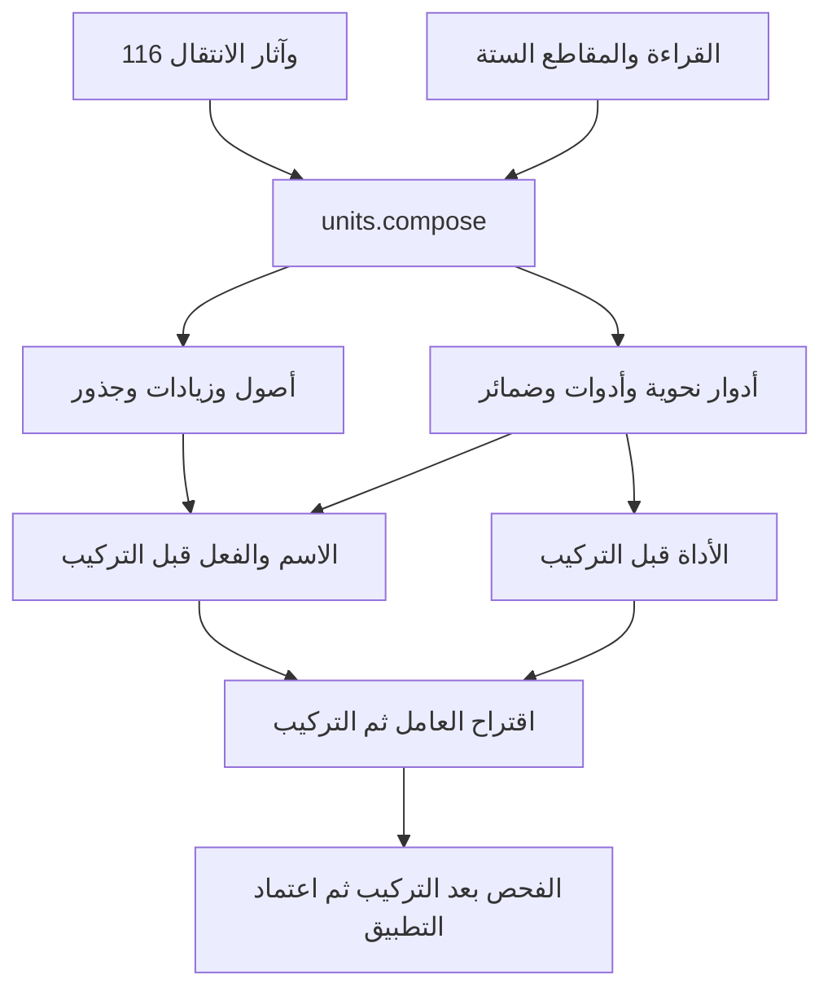

# وكيل تركيب الوحدات واسترجاع شواهدها

يمد هذا التغيير مسار NABT بعد دمج PR 81، انطلاقًا من
`7c86e16c217010c0af09c67886522e6e6f991fa4`. الوكيل التنفيذي
`units.compose` ينسق المولد والآلة والقراء الموجودين، ويعيد فحص الإيصالات؛
لا ينشئ قانون نطق أو اشتقاق ثانيًا. راجع
[عقد القبول السابق للتنفيذ](UNIT_COMPOSITION_AGENT_SPEC_AR.md).

## موضعه في المشروع



الخريطة الأصلية هي `evidence/cognitive_curriculum_v1/learning_framework.json`:
34 ملف وكيل تخصصي، و116 موضوعًا، ضمن الوكلاء الأم الموجودين وعددهم 14،
بعد إضافة [وصلة المقام والزمن](CONTEXT_APPLICATION_AR.md) إلى أساس الوحدات.
هذه تبعيات منهجية وتنفيذية، وليست أعلام إتقان يمنحها صاحب الطلب.
لا يتجاوز الوكيل بوابة `agents gate` أو شروط `CertifiedBridge`.

## ثلاثة مجالات عد لا تختلط

| المجال | العدد/الحد | ما ينفذ |
|---|---:|---|
| خلايا التمثيل | 116 | العرض الأصلي للحامل والحالة والأثر؛ الخلية ليست تلقائيًا مقطع CV |
| حصة C/V | 0..4 من كل رمز، عدا الفراغ | 24 حصة، 250 سلسلة مرتبة باستنفاد Lean |
| أزواج أساس الجمع | C، V، والمقاطع الستة | 64 زوجًا مرتبًا، منها 36 زوج مقطع |
| رباعيات خلايا التمثيل | 116⁴ = 181,063,936 | عنونة تامة وصفحات فحص محدودة، لا ادعاء قياس الكل |
| أشجار التجميع الثنائية | حتى 8 ذرات | جميع التجميعات التي تحفظ الترتيب؛ الأكبر يحمل EXHAUSTED |

لحصتين محددتين c وv، عدد الترتيبات هو `(c+v choose c)`؛ مثلًا
2C و2V تعطي CCVV، CVCV، CVVC، VCCV، VCVC، VVCC.
أما 4C وحدها فشكلها CCCC، و4V وحدها VVVV. هذه شهادات تعداد رمزي،
وليست شهادات جواز اجتماع أربعة صوامت أو أربعة صوائت في مقطع عربي.
V هنا وحدة كمية رمزية؛ لا يثبت تمثيل VV لصائت طويل إلا بشاهد قراءة.

الجمع يحفظ الترتيب؛ `C+V` غير `V+C`. وقد يتساوى سطح
`CV+CVV` و`CVC+VV` مع اختلاف حدود الأجزاء؛ تحفظ هوية التجميع كلاهما.
جميع التقسيمات إلى CV/CVV/CVC/CVVC/CVCC/CVVCC تبقى مقترحات حتى
تثبت شروط القراءة والكمية والموضع. لا يستنتج الوكيل السماع من العد.

فضاء خلايا A116 بطول 1 و2 و3 و4 يضم على التوالي
116 و13,456 و1,560,896 و181,063,936 سلسلة. تستخدم الصفحات
`codec.encode_cells/decode_number` الموجودين؛ آخر صفحة لا تثبت فحص
الصفحات السابقة. `reached_domain_end` منفصل عن `whole_domain_measured`.

## عقد الاسترجاع والتنفيذ

فهرس `units catalog/search` يبني بطاقاته من المصادر الحالية: 116 خلية،
71 قالبًا صرفيًا، 34 تصريح وظيفة من AffixFunctions، و16 مدخلًا من سياسة
قارئ الكلمات، و20 مثالًا صوتيًا مصدرّيًا، وموضوعات المنهج ذات الصلة.
تعاد مواضع الشاهد وبصماته من المالك الموجود. ترتيب BM25/RRF اقتراح فقط.
الفهرس الكامل للمبرهنات يظل الكتالوج المحدد في
`integrations/current_proof_references.mk`؛ لم ينشأ سجل براهين منافس.
تعرض `proof_navigation` معرفات المبرهنات لكل مالك والتزاماته المفتوحة؛
يمكن استرجاع نصوصها وتبعياتها من `agents proofs units.compose`.
علاقة المالك بالمبرهنة لا تدعي أن كل وصلة Python مبرهنة أو أن الأسرة مكتملة.

| العملية | صاحب التنفيذ الحالي | المخرج القابل للمراجعة |
|---|---|---|
| enumerate | progressiveUnitProbe.quota/compose_shapes | الاستنفاد والأشكال والأرقام والأزواج |
| shape | compose_shapes/forest | رقم السطح وهوية الأجزاء وأشجار التجميع |
| cell_page | codec ثم progressiveUnitProbe.cell_effect | عنوان كل سلسلة وأثرها في حالات الدخول الـ97 |
| compose | alignedAcquisition ثم Machine ثم progressiveUnitProbe | الأثر النصي وقطع التحصيل وحدود الكلمات وإيصال الأثر |
| phonology | phonological_modes.realize ثم quantity/shape | المصدر ووضع الابتداء/الوصل والوقف والكمية والبدائل |
| generate | derivation.generate_derivation ثم compose | القالب والجذر المقدم والسطح وتحصيل خلاياه |
| read | word_reader/read_derivation | التحليلات المصدرية المحدودة والبدائل والنواقص |
| weak_application | derivation_surface_bridge | فرضيات الأصل وإيصال التطبيق الشرطي دون ترقيته |
| paradigm | verb_paradigm | تصريحات استعمال صيغ الفعل؛ الغائب ليس منفيًا |

تحفظ `compose` نص كل جزء وموضعه البايتي والفواصل. تجمع آثار أجزاء
الكلمة الواحدة، وتقابلها بجميع صفوف أثر المالك الأصلي. لا تعبر الفراغ إلى
الكلمة التالية، ولا تسمح بحد يقسم قطعة تحصيل مثل الحرف وعلامته.
لا تفترض فتحة على الألف غير المشكولة: يمر «كَاتِبُ» بقاعدة المد الموجودة
في تحصيل المصدر، وتظهر قطعة الألف وخلاياها في الإيصال.

وضع `mode=waqf` في الآلة يختار قبول نهاية الشكل؛ ليس وحده تحويلًا صوتيًا
للوقف. التحويل الصوتي يأتي من عملية `phonology` بالمصدر ووضع القراءة.
قبول أثر قطعة عند مدخل مناسب لا يلزم أن يقبل ابتداء الكلمة بها؛ تُحفظ
دالة الانتقال الكاملة بدل إتلاف القطعة لمجرد رفضها من الحالة صفر.

تسجل كل عملية بصمة لقطة الشيفرة والبيانات والأدوات الأصلية وفق صاحب
اللقطات الموجود، وهوية الإطار المنهجي والكتالوج. التنفيذ الأصلي يسجل
الطلب والجواب كاملين وبصمة الملف التنفيذي قبل الاستدعاء وبعده.
`--verify` يعيد التشغيل من طلب مستقل ويقارن التقرير كاملًا؛ البصمات
تحدد النسخ ولا تقوم مقام برهان تنقيح Python إلى Lean.

## ما يرتبط بهذا الوكيل وما يبقى مطلوبًا

| الأسرة المطلوبة | المسار المرتبط الآن | الالتزام اللغوي الباقي |
|---|---|---|
| أدوات النفي والعطف والاستثناء والاستفهام والشرط والحصر والربط | roles.grammar ثم connector.pre/post، التصريحات وشواهد الفهرس الأصلي | تحقيق المضيف والنطاق لكل استعمال؛ ليس كل تركيب حروف أداة |
| الضمائر المتصلة والمنفصلة | pronouns وقارئ الكلمات وعقود الإحالة الموجودة | شخص وعدد وجنس ثم مرجع ومقام واقتباس |
| الإشارة والاستفهام والموصول والنداء والنفي | built.names وموضوعاته | الصنف يثبت بالاستعمال؛ لا تجمع أدوات النداء وأسماء المنادى تحت حكم البناء نفسه |
| الجذر الثلاثي والرباعي والسالم والمعتل | root.triliteral/quadriliteral ثم weak.laws | ملء الأصول لا يثبت ورود الجذر؛ السطح المعتل له شهادة تحويل مستقلة |
| أجناس الاسم الجامد وأوزانه | genera والمعجم | شاهد الوضع والجنس؛ لا توليد أسماء الأجناس من الوزن وحده |
| المصدر واسم المصدر | masdar، قوالب المصادر المعتمدة، موضوع masdar_ism | لا تسوية آلية بين المصدر واسم المصدر؛ تعيين معجمي ودلالي مستقل |
| اسم الفاعل واسم المفعول | nominal.faail/nominal.mafool | الوظيفة والعمل والمعنى في السياق خارج مجرد ملء القالب |
| الصفات واسم الآلة والمكان والزمان | قوالب grammar.sifa/instrument/place وموضوعات noun.pre | قوالب المكان لا تثبت قراءة الزمان؛ مشاركة الوزن لا تحسم المعنى |
| الماضي المجرد والمزيد والمجهول | قوالب past/passive الموجودة | الشواهد والتعدية وتحويل المعتل محفوظة في أصحابها |
| المضارع للمجرد والمزيد والسالم والمعتل | قوالب imperfect والقراء والتحويلات الموجودة | قائمة الـ71 ليست مولدًا شاملًا لكل التصاريف؛ لا تضيف هذه الدفعة مولد مضارع مجهول شاملًا |
| الأمر | قوالب imperative ومسار القراءة | المجهول الطلبي يتطلب لام الطلب مع المضارع المجهول، لا قالب أمر مجهول مصطنع |
| المستقبل وهيئة الزمن | lang.future، verb.post، موضوع temporal_aspect | فصل هيئة الفعل عن زمن الحدث والمرجع والخطاب والقرائن |
| التمام والنقص والنسخ والتصرف | verb.pre/post وverb_paradigm | التصرف محور مستقل عن التمام والنقص؛ التمكن الاسمي محور مختلف |
| الميزان الصرفي | roles.stem مع sarf_scale | محاذاة كل أصل وزائد وتحويل بالسطح؛ لا استرجاع الجذر بإسقاط أحرف التشابه |

التوضيحان الاصطلاحيان مستندان إلى
[مجمع الملك سلمان، الاستشارة 6126](https://almustashar.ksaa.gov.sa/bank/6126)
و[المعجم الوسيط، المتمكن](https://www.arabicacademy.gov.eg/ar/محرك-البحث/المُتَمَكِّنُ?exact_search=true).
هذه مراجع المنهج، لا مقدمات تشغيل مستخرجة تلقائيًا. حقول `future_pattern=null`
و`attested_word=false` وحدود القارئ ظاهرة في النتائج.

## المنهاج والقياس

1. حصص متدرجة من 1 إلى 4 من C/V، ثم أزواج المقاطع والتجميعات المتكافئة سطحًا.
2. صفحات خلايا 116 وأثرها الكامل، ثم التحصيل من مصدر محفوظ الأجزاء والفواصل.
3. الابتداء والوصل والوقف والكمية من الأمثلة المصدرية، مع إبقاء المقاطع المقترحة.
4. تشغيل القوالب الـ71 على ثلاث مجموعات أصول: train/dev/test، أي 213 تمرينًا.
   الاختبار يحجب الأصول ويحافظ على القوالب نفسها؛ لا يدعي نقلًا إلى قوالب جديدة.
5. إحالة النتائج إلى وكلاء الوظائف والجذور والمعجم، ثم قبل التركيب وبعده، ثم العامل.

التقسيم الرابع اختبار اتساق ونقل شكلي، وليس شاهد ورود جميع الكلمات المولدة.
لا تسجل هذه الدفعة تدريب أوزان نموذج أو إتقانًا عصبيًا أو اكتمال العربية.
الأصل التعليمي اللاحق هو استخدام الإيصالات لإشراف الاقتراح، مع قياس مستقل
لسحب الشاهد وتغيير الحركة والموضع والقراءة والمقام.

## التشغيل

```sh
LAKE=/path/to/lean-4.34.1-linux/bin/lake
"$LAKE" --dir formal build progressiveUnitProbe alignedAcquisition
PYTHONPATH=src:. python -m tools.grammar_catalog units catalog --summary
PYTHONPATH=src:. python -m tools.grammar_catalog units search 'اسم الفاعل'
PYTHONPATH=src:. python -m tools.grammar_catalog units curriculum
PYTHONPATH=src:. python -m tools.grammar_catalog units run --request examples/unit_composition/enumerate.json
PYTHONPATH=src:. python -m tools.grammar_catalog units run --request examples/unit_composition/long_vowel.json --output /tmp/unit.json
PYTHONPATH=src:. python -m tools.grammar_catalog units run --request examples/unit_composition/long_vowel.json --verify /tmp/unit.json
make -f Makefile -f integrations/grammar_catalog.mk unit-composition-agent EVIDENCE_DIR=artifacts/local/unit-agent
```

لصفحة من فضاء 116: `{"op":"cell_page","length":4,"offset":0,"limit":16}`.
الحد 128 سجلًا في الطلب؛ يُحفظ `next_offset` للاستكمال. لا تقلب الميزانية
أو غياب executable إلى رفض لغوي. تعلن بوابة CI صراحة وجوب وجود أصلي
التحصيل والأثر، وتفشل إذا غابا؛ الاختبارات العامة تبين تخطي الاختبارات
الأصلية إذا لم يبنيا.

التحقق المحدد في هذه الدفعة: مرجع تعداد مستقل بالضرب الديكارتي، وأشجار
Catalan، وحدود المصدر والكلمات والعلامات، وتطابق أثر الحالات الـ97،
ورفض التقرير المزور والطلب المعدل، ومراجعة التبعيات وترتيب الوكلاء.
نتائج التشغيل وحدودها محفوظة في `evidence/unit_composition_agent_v1/`.
فُحصت الأزواج الـ13,456 بالفعل في وضع الوصل من المدخل صفر: 9,436
قبول شكل و4,020 رفض شكل، مع إعادة أثر جميع حالات الدخول لكل زوج.
هذه ليست أعداد الكلمات أو الوظائف المرخصة. في تمارين القوالب الـ213:
177 تحصيلًا ناجحًا للخلايا، منها 167 قبول شكل و10 رفض شكل، و36 توقفًا
قبل التحصيل الكامل. تتكرر حالات التوقف في القوالب ذات ألف الوصل غير
المشكولة؛ وتسعة من الرفض تحمل ألف وصل مكسورة في السطح الخام، والعاشرة
سطح ملء مباشر للباب الثامن من «درس». يتطلب استكمالها ربط التحقيق
الصوتي أو التحويل الصرفي المشروط بصاحب التحصيل، ولا يصح تغيير قانون
116 أو اختراع حركة لسد النقص. تُحفظ هذه النتائج لا باعتبارها حكمًا
على صحة الألفاظ العربية، بل قياسًا للوصل التشغيلي الحالي.
لم تتغير نواة Lean أو جداول القانون أو كتالوج المبرهنات؛ لا تسجل هذه
الدفعة `make check` كاملًا أو اعتماد إصدار شاملًا.
